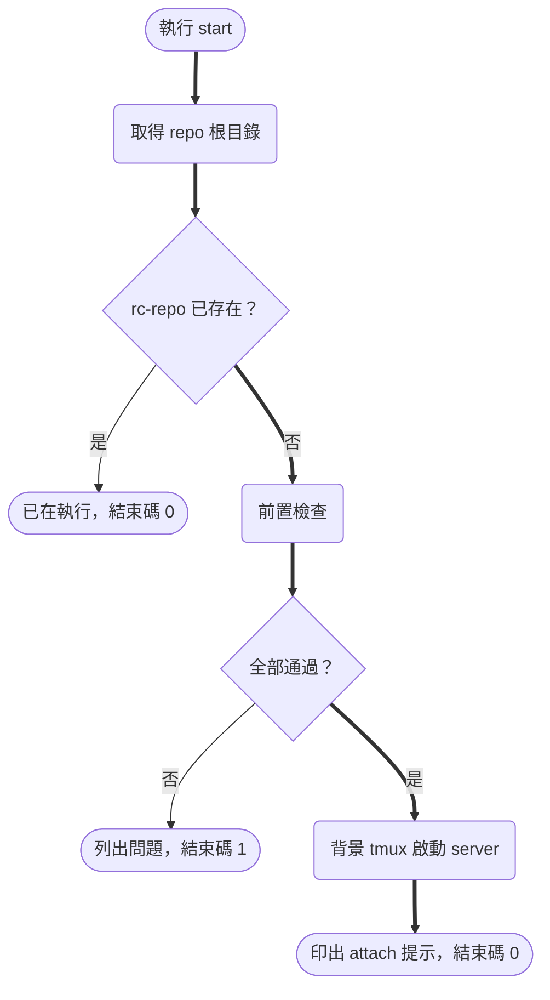
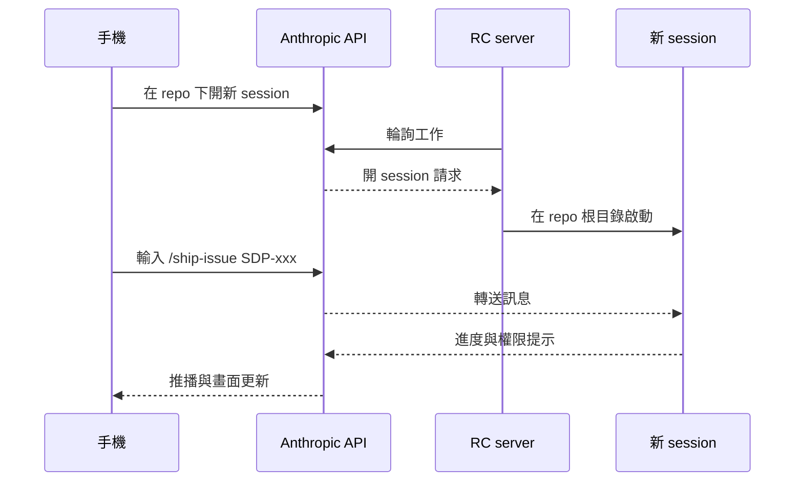

# Design

## Context

- 動機見 proposal.md 的 Why。需求出自 SDP-112，code_city 有同名 change（`sdp-112-remote-control`），兩邊的腳本內容相同。
- Claude Code 2.1.319 的 `claude remote-control` 是 server 模式。它常駐在終端機，可以同時服務多個 session，手機或 claude.ai/code 可以請它開新 session。關掉終端機 server 就停了。電腦醒著但離線約 10 分鐘，server 會自行結束。
- 開啟條件：必須用 claude.ai 訂閱帳號登入，API key 會被拒絕。`ANTHROPIC_BASE_URL` 指向其他位址、設了 `CLAUDE_CODE_DISABLE_NONESSENTIAL_TRAFFIC` 或 `DISABLE_GROWTHBOOK` 時，功能無法使用。
- 專案層 `.claude/settings.json` 的 `remoteControlAtStartup: true` 會被忽略，只有使用者層設定有效。所以 repo 能提供的只有「啟動方式」，不能用設定檔強制開啟。
- 目前環境：WSL2 Ubuntu 24.04、tmux 3.4、`claude auth status` 顯示 `authMethod: claude.ai`。
- 使用者已決定：用 server 模式＋啟動腳本、`--spawn same-dir`、手機開的 session 用 `--permission-mode auto`。

## Goals / Non-Goals

**Goals:**
- 一個指令把 server 掛到背景，關掉終端機也不會停。
- 啟動前把已知會失敗的條件擋下，直接告訴使用者怎麼修，不要等到手機連不上才發現。
- 兩個 repo 用同一份腳本，不需要針對 repo 修改內容。

**Non-Goals:**
- 不改使用者層 `~/.claude/settings.json`（`remoteControlAtStartup`、推播開關）。文件會寫明手動設定的方式。
- 不做開機自動啟動（systemd user service、Windows 工作排程器）。
- 不處理 WSL2 或 Windows 睡眠造成的斷線，只寫進文件。
- 不改 `/ship-issue` 等既有流程。

## Decisions

### D1：腳本放在 `.claude/scripts/`

- 選擇：`.claude/scripts/remote-control.sh`，測試放 `.claude/scripts/tests/remote-control.test.sh`。
- 理由：本 repo 根目錄是 team-hq，只放 `openspec/`、文件與 Agent 設定，`frontend/`、`backend/` 是網站本身的程式碼，都不適合放開發工具。這支腳本是 Claude Code 的開發工具，和 `.claude/hooks/` 同性質。code_city 的 `src/` 只能放 Rust crate，同樣會放在 `.claude/scripts/`，兩邊路徑一致。
- 不放 `.claude/hooks/`：hooks 是 Claude Code 事件呼叫的，而且屬於高風險樣式。這支腳本是人手動執行的，放進去會混淆用途。
- 不放 `frontend/scripts/`：腳本和 Next.js 無關，放進去會讓前端看起來相依於 tmux。

### D2：用 tmux 保持常駐

- 選擇：`tmux new-session -d -s rc-<repo 名> -c <repo 根目錄> 'claude remote-control …'`。
- 理由：server 需要一個 TTY，首次啟動時要回答 `Enable Remote Control? (y/n)` 與資料夾信任提示，QR code 也印在這個 TTY 上。tmux 提供可以接回的 TTY，終端機關了也不會停，系統也已經裝好。
- 替代方案 `nohup … &`：沒有 TTY，首次提示無法回答，也看不到 QR code，不採用。
- 替代方案 systemd user service：WSL2 預設不一定啟用 systemd，而且一樣沒有 TTY 可以回答提示，不採用。

### D3：用 tmux session 名稱判斷 server 有沒有在跑

- 選擇：session 名稱固定為 `rc-<repo 根目錄 basename>`，用 `tmux has-session -t =<名稱>` 判斷（`=` 代表完全比對）。repo 根目錄由 `git rev-parse --show-toplevel` 取得，在 worktree 裡執行時會得到 worktree 的路徑。
- 理由：不需要另外寫 PID 檔，也不會有 PID 檔過期的問題。兩個 repo 的名稱不同，可以同時各跑一個 server。
- 已知限制：tmux session 還在但 `claude` 已經結束（例如離線超過 10 分鐘），`status` 仍會回報執行中。對策：tmux 直接以 `claude remote-control …` 作為 session 的指令（不經過互動 shell），claude 一結束 session 就跟著關閉，判斷結果就會正確。實作時已用真的 tmux 3.4 驗證過這個行為，原本規劃的「指令最後接 `; exit`」並不需要。

### D4：server 參數固定寫在腳本裡

- 選擇：`claude remote-control --name <repo 名> --spawn same-dir --permission-mode auto`。
- 理由：`same-dir` 讓手機開的 session 和平常一樣在 repo 根目錄執行。`/ship-issue` 本來就會在 worktree 根目錄建自己的 worktree，用 `worktree` 模式會多一套 `.claude/worktrees/`，和既有慣例重疊。`auto` 是使用者選的，手機上不需要每個動作都按允許，風險由 auto mode 分類器把關。
- 不開放參數覆寫：需求只有一組固定設定，要改就直接改腳本，不加用不到的選項。

### D5：前置檢查集中在一個函式，失敗時全部列出

- 選擇：`preflight` 依序檢查，把所有不符的項目收集起來一次印出，再以結束碼 1 結束。登入狀態用 `claude auth status` 的 JSON 判斷 `authMethod` 是否為 `claude.ai`。
- 理由：一次看到全部問題，不必修一項跑一次。

### D6：測試用假的 `claude` / `tmux`

- 選擇：測試腳本在暫存目錄放假的 `claude`、`tmux` 執行檔，`PATH` 指向那裡。假執行檔把收到的參數寫進記錄檔，並用一個檔案模擬 session 是否存在。依 AAA 模式驗證各子命令的結束碼、輸出與送給 tmux 的參數。
- 理由：不必真的登入或連到 Anthropic，CI 和沒有 tmux 的環境也能跑。repo 沒有既有的 shell 測試框架，不額外引入 bats，用 bash 寫簡單的 assert 函式即可。

### 啟動流程

先檢查是否已在執行，再做前置檢查。server 已經在跑時，就算環境變數後來被改掉，也不會誤報失敗。

依據：`.claude/scripts/remote-control.sh`（本 change 新增）

### 手機派任務

本機只往外連（HTTPS 443），不開任何對外的 port。session 用 `auto` 權限模式，分類器判定要問人時，提示會推到手機。

依據：`claude remote-control --help`（2.1.319）、https://code.claude.com/docs/en/remote-control.md

## Risks / Trade-offs

- [`auto` 權限模式讓手機開的 session 少問很多動作] → 文件寫明手機端可以隨時切回 Manual。高風險檔案的合併仍有 `/ship-issue` 的停下條件把關。
- [Windows 睡眠或 WSL2 網路中斷約 10 分鐘，server 會自行結束] → 文件寫明重新執行 `start`。server 模式的 session 停止後約 4 小時內，可以用 `claude remote-control --continue` 接回（手動操作，不包進腳本）。
- [連線期間的對話與工具輸出存在 Anthropic 伺服器] → 寫進文件。這兩個 repo 沒有機密資料，可以接受。
- [首次在 repo 啟動要在 TTY 回答確認提示] → `start` 成功後印出 `attach` 指令，文件寫明首次啟動的步驟。
- [littleduck_website 與本 repo 各有一份相同的腳本，日後可能改得不一致] → 兩邊用同名 change 一起改。之後若再修改，也要用同一張 issue 兩邊一起處理。

## Migration Plan

新增檔案，沒有需要遷移的東西。回復方式：執行 `stop`，再移除腳本與文件。

## 影響範圍

只新增 `.claude/scripts/**`、`docs/remote-control.md`，並修改根目錄 README。`frontend/`、`backend/` 的建置、測試、部署都不受影響。
