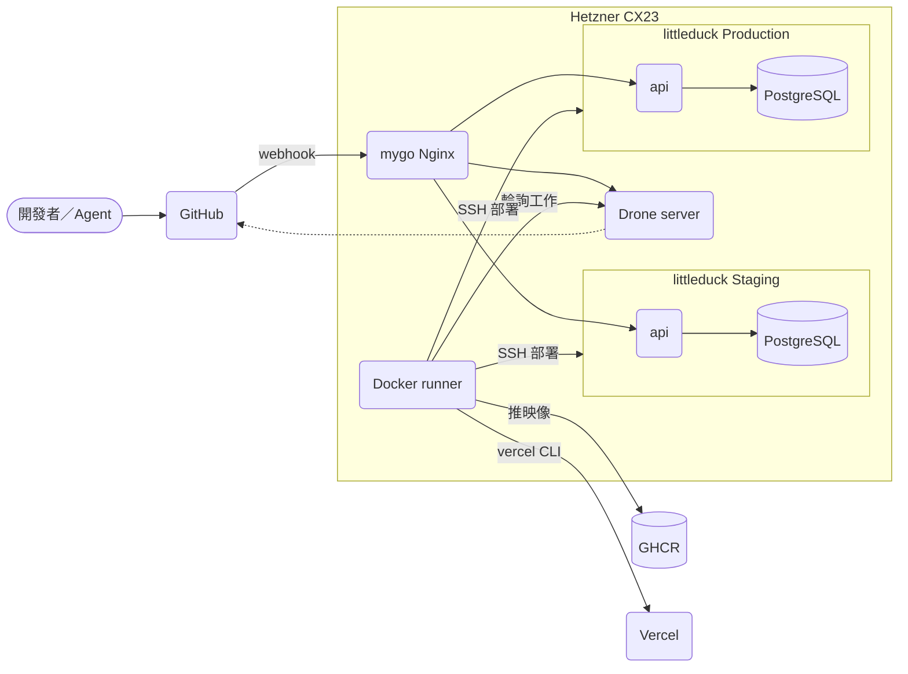
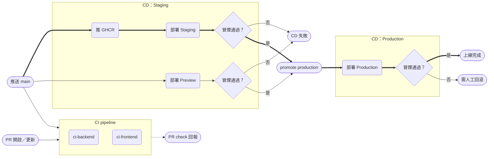

# Design

## Context

動機見 proposal.md「Why」。影響設計的現況：

- **monorepo**：`frontend/`（Next.js 14，無 lint／typecheck 腳本，只有 `test:design`）與 `backend/`（Go 1.26、Gin、PostgreSQL，`go test ./...`、`GET /health`、`GET /api/v1/articles`）在同一個 repo。前端不呼叫後端 API。
- **Hetzner CX23** 已由 mygo_v2_anon 佔用 80／443：其 `docker-compose.prod.yml` 的 Nginx 綁主機埠，用 `mygo-edge` 外部網路接 Staging 容器，TLS 由主機上的 certbot 核發。mygo 的 Jenkins 每次部署會用 `scp` 覆寫主機上的 `nginx/`，所以**直接改主機上的 Nginx 設定會被覆蓋**。
- **mygo_v2_anon 的流程**（`docs/cicd.md` 5.4）：測試 → Bandit → docker build → Trivy → 推 GHCR → SSH 部署 Staging → 健康輪詢 → 冒煙 → ZAP → 人工核准 → SSH 部署 Production → Production 冒煙。本 change 沿用這條骨架，但把 CI 與 CD 拆成不同 pipeline。
- **agent-team**：skill_repo 最新版的 `/ship-issue` 第 7.1 步用 `gh pr view --json statusCheckRollup` 與 `gh pr checks --watch` 等 CI；本 repo 裝的是沒有這一步的舊版。`install.sh agent-team` 對已存在的骨架檔一律略過，升級要手動合併。
- code_city 的同名 change 改用 GitHub Actions（需要 macOS runner），不共用 Drone；兩邊只共用「CI／CD 分開、Staging→人工核准→Production」的流程骨架。

## Goals / Non-Goals

**Goals:**
- PR 上有可被 `/ship-issue` 等待的前後端 check。
- `main` 合併後自動走到 Staging，Production 只在人工 promote 後部署，且部署的是 Staging 驗證過的同一個產物。
- Drone server 的設定與 repo 分開（`deploy/drone/`），日後其他 repo 要用時只需在 Drone 啟用。

**Non-Goals:**
- 不導入 OWASP ZAP：後端目前只有 `/health`、文章列表與金流端點，金流回呼不適合在 Staging 被動掃描；等 API 面變大再加。
- 不做效能基準測試與 LLM eval（mygo 專屬）。
- 不修改 mygo_v2_anon 的 Nginx；所需的 include 改動由 SDP-114 處理。
- 不改前後端的業務邏輯（為清弱點而做的相依升級除外，見 Decisions 2），不新增 lint 工具到前端（現在沒有 ESLint 設定，加 lint 屬另一件事）。

## Decisions

### 1. 架構與部署拓撲

- `DroneServer -.-> GitHub` 是回報 commit status。Nginx 對 Drone 走 `drone.<網域>`，對 api 走 `api.`／`api-staging.` 子網域。
- 依據：mygo_v2_anon `docker-compose.prod.yml`、`nginx/nginx.conf.template`；本 repo `backend/Dockerfile`。

**Drone 用 Docker runner、與部署目標同主機**：runner 需要 docker.sock 才能跑 Trivy 與 `docker build`。替代方案是另租一台 runner 主機，但 CX23 目前負載低、單人專案建置頻率低，先同機並以 `DRONE_RUNNER_CAPACITY=1` 限制同時建置數，避免排擠 Production。

**SSH 部署而不是 runner 直接 `docker compose up`**：runner 雖在同一台主機，仍沿用 mygo 的「專用 `deploy` 帳號＋SSH」模式。好處是部署權限與 runner 的 docker.sock 權限分開，日後 runner 搬家不用改流水線。部署帳號沿用 mygo 的 `deploy`，但另發一把 `drone-deploy` 金鑰，與 Jenkins 用的金鑰分開撤銷。

**Nginx 以 include 目錄接新站台**：在 mygo 的 Nginx 加掛主機目錄 `/opt/edge-sites/` 並 `include /etc/nginx/edge-sites/*.conf`；本 repo 的 `deploy/edge/*.conf` 由 CD 同步到該目錄後 `nginx -s reload`。替代方案（把 server block 寫進 mygo 的 template）會讓兩個 repo 的部署互相覆寫。這是 mygo_v2_anon 的前置變更，未完成前 littleduck 的 api 與 Drone 無法對外。

### 2. CI 與 CD 的分界

- CI 與 CD 是 `.drone.yml` 裡不同的 pipeline，各自的 `trigger` 決定觸發事件；CD pipeline `depends_on` 對應的 CI pipeline，CI 沒過不部署。
- promote 時 Drone 以同一個 build 的 commit 執行 `target: production` 的 pipeline，所以 Production 一定是 Staging 驗證過的版本；後端用不可變的 `<version-sha>` tag 確保映像相同。
- 依據：本 change 的 `specs/ci-pipeline`、`specs/backend-delivery`、`specs/frontend-delivery`。

**人工核准用 Drone promote**：Drone 沒有 Jenkins `input` 那種暫停中的關卡，對應做法是 promote——在建置頁按「Deploy」選 `production`，或 `drone build promote <repo> <build> production`。好處是核准不會佔住 runner 24 小時。

**PR 建置拿不到部署 secret**：部署 secret 都設成「不給 pull request 使用」，CD pipeline 只在 `push`（`branch: main`）與 `promote` 事件觸發。

**後端 CI 的工具對照 mygo**：Bandit → `gosec`；Trivy 映像掃描沿用並加 `backend/.trivyignore`；mygo 的整合測試用臨時 Redis，這裡改成 Drone `services` 起臨時 PostgreSQL 16。

**前端交給 Vercel CLI 而不是 Vercel Git 整合**：Git 整合會在每次推送自動部署，繞過 Drone 的核准。改用 `vercel pull`→`vercel build`→`vercel deploy --prebuilt`（Preview）與 `--prod`（Production），並在 `vercel.json` 設 `git.deploymentEnabled: false`。Vercel 專案的 Root Directory 設成 `frontend`。

**先清弱點再上門檻**（實作時發現）：現行 `main` 的後端映像有 pgx CRITICAL 與 `golang.org/x/*` HIGH，前端 npm audit 有 next CRITICAL。替代方案是登記例外或讓門檻只報告不擋，但前者會讓 next 的 CRITICAL 長期掛著，後者違反 spec「有弱點就失敗」。user 決定直接升級：Go 模組為非破壞性升級；Next 14 → 16 為 major，本專案頁面全是 client component、沒有 server action、middleware 或 `next/image`，唯一受影響的是 `blog/[id]` 以同步方式讀 `params`，改用 `useParams()`。Tailwind 3 與 PostCSS 設定在 Next 16 照常可用，不在本次升級。

### 3. agent-team kit 升級

照 code_city 的 team-hq 設定改成**單一 repo**：`frontend/` 與 `backend/` 在同一個 repo、同一條分支、一個 PR；Chika 負責 `backend/**`、Yuma 負責 `frontend/**`，寫入範圍 hook 依子目錄限制。`CLAUDE.md` 補「合併方式 `--merge`」「CI 等待上限 30 分鐘」「高風險檔案樣式」「風險分級」「執行驗證」。骨架檔（`ship-issue.md`、agents、hooks、templates）以 skill_repo 最新版為底手動合併，因為 `install.sh agent-team` 不覆寫已存在的檔；角色 skill 由 installer 覆寫更新。

## Risks / Trade-offs

- [Next 16／React 19 升級可能改變畫面行為] → 升級後以 `npm run start` 實際開首頁、部落格列表與文章頁檢查；設計同步工具（`npm run test:design`）一併跑。
- [Drone 已進入維護模式，後繼是 Harness Open Source] → `.drone.yml` 格式在 Harness Open Source 仍可讀；本 change 只用 Drone 的基本功能（pipeline、services、secret、promote），日後要遷移成本低。
- [Drone 映像的授權：官方 `drone/drone` 為企業版建置，個人或年營收低於一百萬美元的組織免費] → 在 runbook 註明；若條件改變，改用自行編譯的開源版（`-tags oss`）。
- [Runner 與 Production 同機，建置吃滿 CPU 會拖慢線上服務] → `DRONE_RUNNER_CAPACITY=1`、Drone 相關容器設 `deploy.resources.limits`。
- [runner 掛 docker.sock 等同主機 root] → 只啟用自己的 repo、PR 來自 fork 時不跑（`DRONE_REPO` 設為私人或在 Drone 設定 trusted 為 false），部署 secret 不給 PR。
- [mygo_v2_anon 的 Nginx include 尚未存在] → 先完成 mygo 的前置 issue；本 change 的部署任務在此之前先停在「Drone 只在主機內可連」的驗證。
- [Vercel 專案若尚未建立或已開 Git 整合] → runbook 列出建立專案、關閉 Git 部署、取得 `VERCEL_ORG_ID`／`VERCEL_PROJECT_ID`／token 的步驟。

## Migration Plan

1. mygo_v2_anon 前置：Nginx 掛 `/opt/edge-sites/` 並 include（SDP-114）。
2. DNS 加 `drone.`、`api.`、`api-staging.` 子網域，certbot 核發憑證。
3. 主機建 `/opt/drone`、`/opt/littleduck-api`、`/opt/littleduck-api-staging`，放 env 檔；GitHub 建 OAuth App；啟動 Drone。
4. Drone 啟用 littleduck_website，設 secret；開一個只改文件的 PR 驗證 CI check 出現。
5. 合併後確認 Staging／Preview 部署，再 promote 驗證 Production。
6. 升級 agent-team kit。

**回滾**：Production 依 runbook 指定前一個 `<version-sha>` 重新 `up -d`；前端用 `vercel rollback` 或在 Vercel 介面把前一個部署設為 Production。Drone 本身出問題時停掉 `/opt/drone` 的 compose 即可，不影響線上服務。

## Open Questions

- 正式網域名稱（`<網域>` 用 littleduck 自己的網域，或沿用 `stevenshih-littleduck.com` 的子網域）：只影響 env 與 DNS 設定值，不影響流程。
