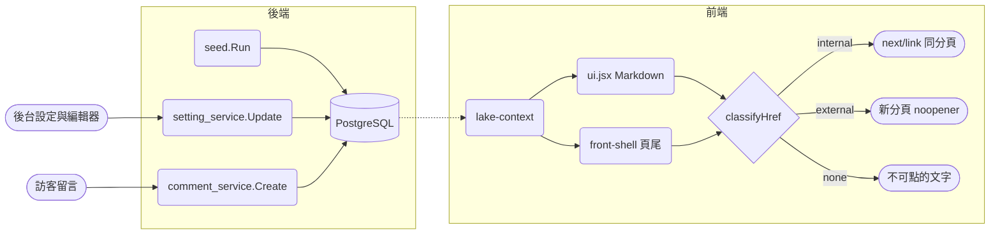
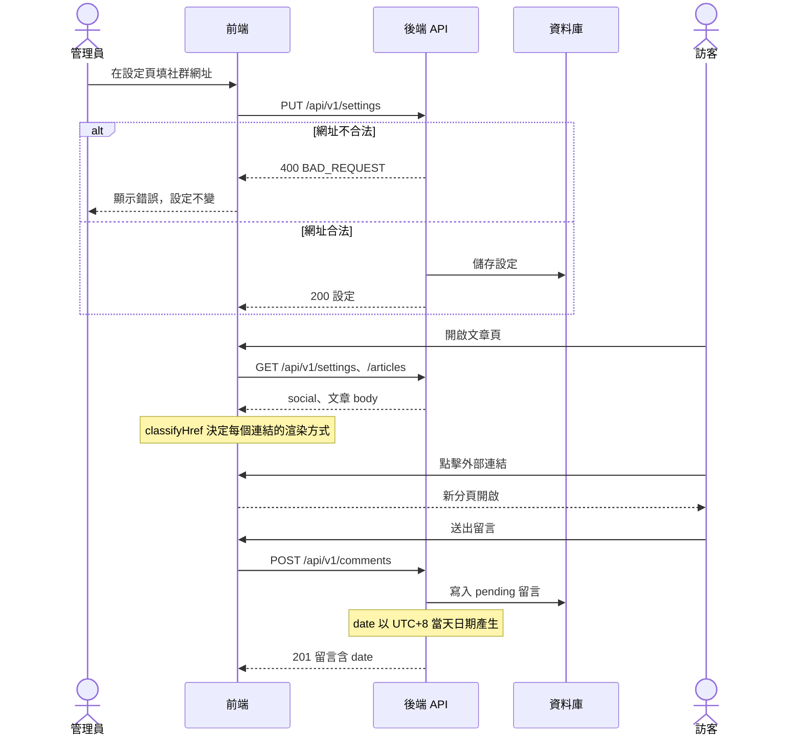

# Design：前台內容收尾（SDP-105）

## Context

動機見 proposal.md「Why」。以下是 2026-11-12 對照程式碼的現況：

- **日期**
  - `frontend/store/lake.js` 的 `Lake.today()` 在 SDP-103 已改為取瀏覽器當天日期，只用在留言板標頭與後台新增文章的 `date`。issue 描述的寫死問題已不存在。
  - 留言的 `date` 由後端 `backend/internal/service/comment_service.go` 的 `Create` 以 `s.now().Format("2006 / 01 / 02")` 產生；`s.now` 是 `time.Now`，容器（`backend/Dockerfile`，alpine，裝了 tzdata 但沒設 `TZ`）與部署設定都沒指定時區，所以是 UTC。台灣時間 00:00–08:00 的留言會記成前一天。
  - 贊助紀錄目前只有 seed 資料，前台贊助按鈕不寫入（`sponsor-fab.jsx` 註明屬 SDP-104），沒有日期要修。
  - `frontend/components/admin/admin-posts.jsx` 新增文章時 `y: 2026` 寫死。
- **連結**
  - `frontend/components/ui.jsx` 的 `mdInline` 與 `frontend/components/front/front-shell.jsx` 的頁尾社群連結都用 `onClick={e => e.preventDefault()}`。
  - 社群連結資料來自 `GET /api/v1/settings` 的 `social`，seed（`backend/internal/seed/seed_data.go` `buildSetting`）四個網址都是 `#`。後台「設定」頁已能編輯（`admin-settings.jsx`），後端 `setting_service.Update` 只驗證標題。
  - 拿掉 `preventDefault` 後，管理員可輸入的網址會直接成為 `href`。React 19 對 `javascript:` 只警告不一定阻擋，需要自行過濾。
- **內文**
  - 「整理中」佔位在 `seed_data.go` 的 `buildArticles`：小說 `a1`–`a12` 為 `"> " + blurb + "\n\n（全文整理中，之後由後台補上。）"`；專案 `p1`–`p7` 結尾為 `（專案介紹整理中，之後由後台補上。）`，其中「連結」欄位是「GitHub 連結」這類文字而非網址。
  - `seed.Run` 只在資料表為空時寫入。Staging／Production 已有資料，**單改 seed 不會更新線上內容**。
- **設計同步**
  - `frontend/design-sync/manifest.json` 只有整檔層級的 `divergent` 標記（SDP-103 用於 `store/lake.js`）。`ui.jsx` 對應 `project/v2/ui.jsx`，`front-shell.jsx` 與另三個前端檔共用 `project/v2/front-home.jsx`，`admin-posts.jsx` 與另四個檔共用 `project/v2/admin-manage.jsx`。整檔標 `divergent` 會讓這些檔案之後都收不到設計更新。
  - `design-sync.mjs` 的 `buildManifest` 對非分歧項目只保留 `sha256` 與 `targets`，任何額外欄位都會在更新基準時被丟掉。

## Goals / Non-Goals

**Goals:**

- 留言日期與後台新增文章的年份正確。
- 前台內文與社群連結可點擊，且不會因此開出 XSS 或 reverse tabnabbing。
- 偏離設計的行為能在之後的 `/design-pull` 中被看見並保留，同時不阻斷這些檔案的其他設計更新。
**Non-Goals:**

- 不編造任何文章內文或社群網址；也不改 seed。user 決定（2026-11-12）上線後在後台自行填寫（D5）。
- 不實作贊助寫入與金流（SDP-104）。
- 不改 Markdown 渲染器的其他語法支援、不換成第三方 Markdown 套件。
- 不改資料表結構（`backend/internal/model/**`）。
- 不改 `.claude/skills/design-pull/SKILL.md`（由 littleduck-skills 安裝，且 `design:check` 的報告已會列出偏離）。

## Decisions

### D1 留言日期用固定 UTC+8

`comment_service` 以 `now().In(taipeiZone)` 格式化，`taipeiZone = time.FixedZone("Asia/Taipei", 8*60*60)`。

- 選 `FixedZone` 而非 `time.LoadLocation("Asia/Taipei")`：台灣沒有日光節約，結果相同；不依賴執行環境的 zoneinfo（CI 的 golang 映像、alpine 映像都不必再確認），也沒有載入失敗的錯誤分支。
- 不改容器 `TZ`：會動到 `Dockerfile`／部署設定（高風險樣式），且影響 `stat_service` 的日統計等其他時間計算，超出本 issue。
- 不做成環境變數：個人網站只服務單一時區，YAGNI。
- 測試以注入的 `now` 驗證跨日邊界（UTC 19:00 → 隔天）。

### D2 社群連結網址：後端驗證、前端分類

**後端**（`setting_service.Update`）：在既有標題驗證之後，逐筆檢查 `social[].url`。合法：`""`、`"#"`、以單一 `/` 開頭、或 scheme（不分大小寫、去除前後空白後判斷）為 `http:`、`https:`、`mailto:`。不合法回 `apperror.BadRequest("社群連結網址格式不正確")`，不寫入。

- 接受 `#` 與空字串：既有線上資料是 `#`，若拒絕，管理員改其他設定時會整張表存不了。
- 只有管理員能寫入，這是縱深防禦；前端仍需自行過濾（文章內文的連結沒有後端驗證）。

**前端**（新增 `frontend/lib/safe-url.mjs`，純函式、無相依）：`classifyHref(raw)` 回傳 `{ kind: "internal" | "external" | "none", href }`。

| 輸入 | kind |
|------|------|
| 以單一 `/` 開頭 | `internal` |
| scheme 為 `http:`、`https:`、`mailto:`（不分大小寫，先去空白） | `external` |
| 空、`#`、`#…`、`//…`、其他 scheme、相對路徑（如 `foo/bar`） | `none` |

- `ui.jsx`：`internal` → `next/link` 的 `Link`；`external` → `<a target="_blank" rel="noopener noreferrer">`；`none` → `<span>` 只顯示文字。
- `front-shell.jsx`：`internal`／`external` 同上；`none` 渲染為不可點的 `<span>`，仍顯示 `label`，不帶 `cursor-pointer` 與 hover 效果（user 決定：佔位網址仍顯示名稱，不隱藏）。
- 副檔名用 `.mjs`：讓 `node --test` 能直接 import（`frontend/package.json` 沒有 `"type": "module"`），Next 與 `jsconfig.json`（`include` 已含 `lib` 與 `*.mjs`）都能處理。
- 測試接進既有的 `npm run test:design`：腳本改為 `node --test scripts/design-sync.test.mjs lib/*.test.mjs`。CI 與 Teshima 的測試指令是 `npm run test:design`，不另開新腳本就不必動 `.drone.yml`（高風險檔案）。代價是腳本名稱不再只代表設計同步，記在 Risks。
- 否決「白名單只放 https」：`mailto:` 與站內路徑在文章中很常見。否決「把站內連結也用 `<a>`」：會整頁重載、丟掉前端狀態。

### D3 後台新增文章年份

`admin-posts.jsx` 的 `y: 2026` 改為 `new Date().getFullYear()`，與同一行的 `date: Lake.today()` 一致取瀏覽器當下。

### D4 設計同步：新增 `deviations` 紀錄

manifest 每個設計檔項目可加 `deviations` 陣列：

```json
"deviations": [
  { "target": "components/ui.jsx", "issue": "SDP-105", "since": "2026-11-12",
    "note": "mdInline 的連結不 preventDefault，改用 lib/safe-url.mjs 分類渲染" }
]
```

- `buildManifest`：非分歧項目改為 `{ sha256, targets, ...(prev.deviations && { deviations }) }`，更新基準時保留。
- `diff` 的 `changed` 項目帶出 `deviations`；`formatReport` 在該項目下列出「保留偏離：<target> — <note>（<issue>）」。
- 本次登記三筆：`project/v2/ui.jsx` → `components/ui.jsx`；`project/v2/front-home.jsx` → `components/front/front-shell.jsx`；`project/v2/admin-manage.jsx` → `components/admin/admin-posts.jsx`。`store/lake.js` 已整檔 `divergent`，不重複登記。
- 否決整檔 `divergent`：會讓 `front-home.jsx`、`admin-manage.jsx` 對應的另 7 個前端檔一起停止同步。否決只在程式碼寫註解：`/design-pull` 是看差異報告決定移植範圍，註解不會出現在報告裡。
- 否決「先改設計再同步」：設計在 claude.ai，Agent 不能寫入 artifact（`design-pull` 護欄）；若 user 之後改了設計，屆時刪掉對應的 `deviations` 即可。

### D5 真實內容由 user 在後台填寫

user 決定（2026-11-12）：小說與專案內文、社群網址與專案連結，上線後都由 user 在後台「設定」頁與文章編輯器填寫；`seed_data.go` 維持現狀，本次不改 seed、不做資料升級。

- 後台已能編輯這些欄位（`admin-settings.jsx`、`admin-editor.jsx`），不需要新功能。
- 否決「改 seed 並在啟動時升級佔位資料」：user 不提供內容進 repo，就沒有要寫入的值。

## 資料流圖



- `seed.Run` 只在空表寫入，本次不改；真實內容經由後台設定與編輯器寫入。
- `CommentSvc` 以 UTC+8 產生 `date`；`SettingSvc` 拒絕不合法的 `social[].url`。

依據：`backend/internal/seed/seed.go`、`backend/internal/service/setting_service.go`、`backend/internal/service/comment_service.go`、`frontend/store/lake-context.jsx`、`frontend/components/ui.jsx`、`frontend/components/front/front-shell.jsx`

## 前後端互動時序圖



| participant | 對應 |
|------|------|
| 前端 | `admin-settings.jsx`、`article-page.jsx`、`guest-page.jsx`、`front-shell.jsx` |
| 後端 API | `setting_controller.go`、`article_controller.go`、`comment_controller.go` |

依據：`backend/internal/router/router.go`、`frontend/store/lake-context.jsx`

## 執行驗證觀察點

指令在 worktree 根目錄執行，沿用 `CLAUDE.md`「## 執行驗證」的啟動方式（後端 18080、前端 3100，compose 的預設管理員帳密 `admin`／`admin1234`）。

1. **留言日期為台灣當天**：`curl -s -X POST localhost:18080/api/v1/comments -H 'Content-Type: application/json' -d '{"name":"sdp105-obs","text":"date check"}' | jq -r .data.date` → 與 `TZ=Asia/Taipei date +'%Y / %m / %d'` 的輸出相同（在台灣時間 00:00–08:00 執行時，舊版會差一天）。
2. **不安全的社群網址被拒**：
   `TOKEN=$(curl -s -X POST localhost:18080/api/v1/auth/login -H 'Content-Type: application/json' -d '{"username":"admin","password":"admin1234"}' | jq -r .data.token); curl -s localhost:18080/api/v1/settings | jq '.data | .social[0].url = "javascript:alert(1)"' | curl -s -o /dev/null -w '%{http_code}' -X PUT localhost:18080/api/v1/settings -H "Authorization: Bearer $TOKEN" -H 'Content-Type: application/json' --data @-` → `400`
3. **被拒後設定未變**：`curl -s localhost:18080/api/v1/settings | jq -r '.data.social[0].url'` → 不是 `javascript:alert(1)`（空資料庫時為 seed 值）。
4. **合法網址可存**：同 2，但把 `.social[0].url` 設為 `"https://example.com"` → `200`；再 `curl -s localhost:18080/api/v1/settings | jq -r '.data.social[0].url'` → `https://example.com`。
5. **前端建置產物已含外部連結屬性**：`grep -rl 'noopener noreferrer' frontend/.next/static/chunks | wc -l` → 大於 `0`。

前端的點擊行為（同分頁／新分頁、佔位社群連結顯示為不可點文字）是在用戶端載入資料後才渲染，`curl` 取得的 SSR HTML 看不到；專案也還沒設定截圖工具（`docs/multi-agent-workflow.md`「（可選）截圖觀察點要先裝好固定版本的截圖工具」），所以此部分由 `lib/safe-url.test.mjs` 單元測試與 Akafuku 審查涵蓋，不列截圖觀察點。

## 變異測試目標

| 目標 | 理由 | 對應任務 |
|------|------|------|
| `frontend/lib/safe-url.mjs` | 決定哪些網址能成為可點擊連結，是防 XSS 的唯一前端關卡 | 3.1 |
| `backend/internal/service/setting_service.go`（社群網址驗證） | 後端寫入關卡，邊界條件多（`//`、大小寫、空白） | 2.2 |
| `backend/internal/service/comment_service.go`（日期時區） | 跨日邊界的時區換算 | 2.1 |

本專案尚未設定變異測試指令，Teshima 會記為「略過」。

## Risks / Trade-offs

- [線上資料仍是 `#`，頁尾社群連結在填網址前都是不可點的文字] → user 已知並同意，上線後在後台填網址。
- [`test:design` 名稱不再只代表設計同步] → 在 `package.json` 腳本旁不能寫註解，改在 `lib/safe-url.test.mjs` 開頭註明由 `test:design` 執行；之後若要改名需連動 `.drone.yml`，另開 issue。
- [`next/link` 包住 Markdown 內的站內連結，`ui.jsx` 需 import `next/link`] → `ui.jsx` 已是 client component，可直接使用；在 manifest `deviations` 記錄。
- [`/design-pull` 移植者仍可能忽略報告中的偏離] → 偏離同時寫在報告與程式碼行內註解（`// SDP-105：刻意偏離設計…`）。

## Migration Plan

- 沒有 schema 變更，也不改 seed。部署順序無限制：後端先上時，前端舊版仍 `preventDefault`，不影響；前端先上時，`#` 的社群連結顯示為不可點文字。
- 上線後由 user 在後台填入真實內文與網址。回滾：直接部署前一版，資料不受影響。
