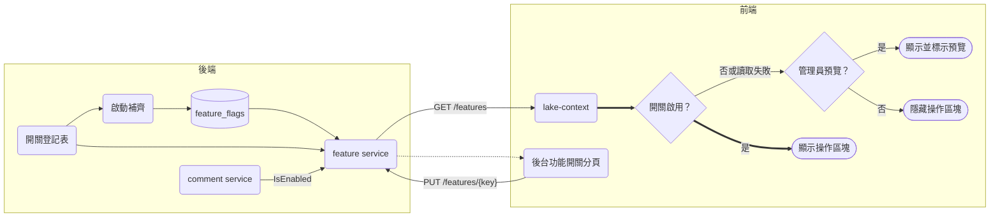
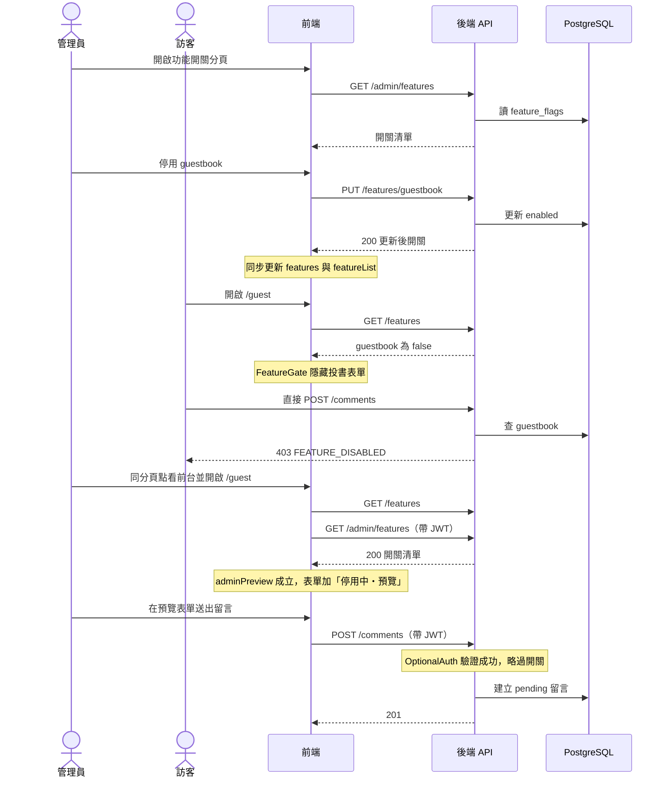

# Design：功能開關（SDP-149）

## Context

- 動機見 proposal.md「Why」。
- 後端已有單一管理員帳密 + JWT（`admin-auth`），受保護路由在 `backend/internal/router/router.go` 的 `admin` 群組；「後台」即前端 `/admin`（`components/admin/admin-shell.jsx` 的分頁）。
- 網站設定是單列 `site_settings`（`model.SiteSetting`），以整份 PUT 覆寫。前台資料由 `store/lake-context.jsx` 的 `loadPublic` 以 `Promise.all` 一次載入，任一失敗即整頁錯誤。
- 前台目前一般瀏覽者可操作的區塊：贊助浮動按鈕（`components/front/sponsor-fab.jsx`，由 `front-shell.jsx` 掛載）、留言板投書表單（`guest-page.jsx`）、文章留言表單（`article-page.jsx` 的留言區）。其他為導覽、主題切換、字級等純顯示偏好。
- 這些前端檔都是設計稿對應檔，改動要在 `frontend/design-sync/manifest.json` 登記 `deviations`（SDP-105 建立的機制）。
- 回應封包 `{code, message, data}`；欄位命名既有混用（`articleId` 駝峰、`created_at` 底線），本次沿用：一般欄位駝峰、時間欄位 `updated_at`。

## Goals / Non-Goals

**Goals:**
- 一個可擴充的開關機制：新增功能只要在登記表加一列、前端包一層 `FeatureGate`。
- 後台可即時切換，前台立即反映；後端對有公開寫入端點的功能同步把關。
- 失敗安全：開關讀不到時視為停用，但不拖垮整頁。

**Non-Goals:**
- 不做依使用者、百分比、地區的灰度發布；開關只有全站啟用／停用兩態。
- 管理員預覽不另做「預覽模式開關」：只要符合 D6 的條件就自動進入預覽，不提供管理員在前台切回「以訪客身分檢視」。要看訪客畫面可登出或開無痕視窗。
- 不對後台分頁本身套開關；後台只有管理員能進入。
- 不對 `POST /api/v1/payments` 加把關：該端點目前回 501 骨架，且屬高風險金流檔案，留待 SDP-104 串金流時一併處理。
- 不修改 repo 根目錄 `CLAUDE.md`（見 proposal.md「CLAUDE.md 開發原則」）。

## Decisions

### D1 獨立資料表 `feature_flags`，不併入 `site_settings`
- 欄位：`key`（主鍵，varchar 64）、`enabled`（bool, not null）、`created_at`、`updated_at`。名稱與說明不入庫，放程式碼登記表。
- 理由：`site_settings` 是整份覆寫的單列，把開關塞進去會讓「網站設定」頁的儲存意外覆蓋開關，且每加一個功能都要改 model 欄位。獨立表一列一開關，新增功能不用動 schema。
- 替代方案：`SiteSetting` 加 `Features map[string]bool`（JSON 欄位）——否決，原因同上。
- 注意：GORM 對 bool 的 `default:true` tag 會把 `false` 當零值略過，**不要**在 `enabled` 加 `default` tag，建立時明確寫值。

### D2 登記表（registry）在後端程式碼，啟動時補齊
- `backend/internal/service/feature_service.go` 內定義有序的 `[]FeatureDef{Key, Name, Description, Default}`；初始三列：
  | Key | Name | Default |
  |-----|------|---------|
  | `sponsor` | 贊助按鈕 | true |
  | `guestbook` | 留言板投書 | true |
  | `article_comments` | 文章留言 | true |
- 啟動 seed（`seed.Run`）呼叫 `EnsureDefaults`：只建立資料庫沒有的 key，不覆寫既有值（與既有「表為空才 seed」不同，因為之後新增的 key 要能補進既有資料庫）。
- 讀取時以登記表為準：DB 有、登記表沒有的 key 忽略；登記表有、DB 沒有（理論上不會發生）回登記表預設值。
- 理由：key 寫死在程式碼才能讓前後端與審查看得到「有哪些開關」，也避免後台任意新增無意義的 key。

### D3 端點沿用既有命名慣例
| Method | Path | 存取 | 說明 |
|--------|------|------|------|
| GET | `/api/v1/features` | 公開 | `data` 為 `{ "<key>": boolean }` |
| GET | `/api/v1/admin/features` | JWT | `data` 為 `[{key, name, description, enabled, updated_at}]`，依登記表順序 |
| PUT | `/api/v1/features/{key}` | JWT | body `{"enabled": boolean}`，回單筆 |

- 比照 `GET /settings`（公開）／`PUT /settings`（JWT）、`GET /admin/articles`（JWT 清單）。
- 公開端點只回布林對照表，不洩漏名稱與說明（未上線功能名稱不對外）。
- `enabled` 用 `*bool` 綁定以區分「缺欄位」與 `false`；缺欄位或型別錯回 400。未知 key 回 404。

### D4 留言張貼的後端把關
- `commentService` 注入一個只有 `IsEnabled(key string) (bool, error)` 的介面（由 feature service 實作）。`Create` 的簽章改為 `Create(in CommentInput, asAdmin bool)`，在欄位驗證之後：`asAdmin` 為 true 直接略過開關檢查；否則依 `ArticleID == ""` → `guestbook`、其他 → `article_comments` 檢查，停用回 `apperror.FeatureDisabled(...)`（403，code `FEATURE_DISABLED`）。
- 開關讀取失敗時（非管理員）回 500（不默默放行），與前端 fail-closed 一致。
- 開關判斷放在 service，不放在 middleware：key 取決於 body 的 `articleId`。
- 每次請求讀 DB 一次，流量小，不加快取（避免多實例下的快取一致性問題）。

### D4-1 管理員身分：選用式驗證 `OptionalAuth`
- `backend/internal/middleware/auth.go` 新增 `OptionalAuth(svc auth.Service)`：有 `Authorization: Bearer` 且 `svc.Parse` 成功時，與 `Auth` 一樣 `c.Set(ContextKeyAdmin, subject)`；標頭缺失、格式錯誤、權杖無效或過期時**不中止、不回 401**，直接放行為訪客。標頭解析與 `Auth` 共用同一個內部函式，避免兩套解析邏輯。
- 只掛在 `POST /api/v1/comments` 這一條公開路由；`CommentController.Create` 以 `c.Get(ContextKeyAdmin)` 判斷 `asAdmin` 傳給 service。
- 取捨：
  | 方案 | 優點 | 缺點 | 結論 |
  |------|------|------|------|
  | 帶有效 JWT 放行（採用） | 預覽能端到端試用真實流程，與 user「可試用」的要求一致 | 預覽留言會成為真實的 pending 資料；`middleware/**` 進入 diff | 採用。留言本來就要審核，不會自動公開；管理員可在留言管理隱藏或忽略 |
  | 預覽時前端假送出、不打 API | 不碰後端 | 不是真正的試用，送出後的錯誤與審核流程測不到 | 否決 |
  | 預覽時仍回 403 | 最簡單 | 管理員看得到表單卻送不出去，等於沒試用 | 否決 |
  | 新增專用的 `/admin/comments` 建立端點 | 公開端點不需讀權杖 | 前端預覽要走另一條呼叫路徑，與正式流程不一致 | 否決 |
- 安全面：權杖驗證沿用 `auth.Service.Parse`（同簽章、同過期判斷），只放寬「開關」這一項限制；名稱、內容驗證與 pending 狀態對管理員一樣適用。無效權杖不回 401，避免訪客 sessionStorage 殘留的過期權杖讓一般留言失敗。

### D6 前台的管理員預覽
- 判斷依據沿用既有登入狀態：`lake-context` 的 `authed`（sessionStorage 有 `lake_token`）**且** `db.featureList` 已由 `GET /admin/features` 成功載入（`adminPreview = authed && featureList !== null`）。只有權杖存在不夠，要有一次後端驗證成功的請求才進入預覽；收到 401 時既有的 unauthorized handler 會把 `authed` 設為 false，預覽隨之退出。`logout` 時清掉 `featureList`。
- 既有初始化流程已在有權杖時呼叫 `reloadAdmin`，本次在其中加入 `/admin/features`，所以從後台按「看前台」或在同分頁開前台都會進入預覽。sessionStorage 不跨分頁，新分頁是訪客畫面（符合 sessionStorage 既有設計）。
- `lib/feature-flags.mjs` 新增純函式 `gateMode(flags, key, adminPreview)` → `"show"`（啟用）／`"preview"`（停用且 `adminPreview`）／`"hide"`（其他）；`FeatureGate` 依結果：`show` 直接渲染、`preview` 以虛線外框包住並在角落加「停用中・預覽」小標（`mono`、`v-acc` 色系，兩種主題都可讀）、`hide` 回 `null`。
- `SponsorFab` 是固定定位的浮動按鈕，外框包不到；`FeatureGate` 支援 `badge="inline"`／預設外框兩種呈現，`SponsorFab` 改為接受 `preview` prop，在按鈕旁與視窗標題列顯示同樣的小標。
- 管理員預覽送出留言時，`lib/api.js` 的 `request` 已自動附上權杖，前端不需要另外處理。

### D7 安全邊界摘要
- 前台的 `adminPreview` 只影響「畫面顯示」；伺服器端的放行只看 JWT 驗證結果。偽造的 sessionStorage 權杖會在 `GET /admin/features` 收到 401，不會進入預覽；即使有人改前端程式強制顯示表單，送出仍會被 403。

### D5 前端：資料層、`FeatureGate` 與 fail-closed
- `frontend/lib/feature-flags.mjs`：純函式 `isFeatureEnabled(flags, key)`（只有值嚴格為 `true` 才回 true）與 key 常數 `FEATURES`；以 `node --test` 測試（`npm run test:design` 已涵蓋 `lib/*.test.mjs`）。
- `lake-context.jsx`：`loadPublic` 中**另外**請求 `/features`，失敗只記錄、把 `features` 設為 `{}`，不設 `error`、不影響其他資料；提供 `features`、`featuresLoaded`、`isEnabled(key)`。後台登入後於 `reloadAdmin` 讀 `/admin/features` 放 `db.featureList`；`setFeatureEnabled(key, enabled)` 成功後同步更新 `features` 與 `featureList`。
- `components/feature-gate.jsx`：`<FeatureGate flag={FEATURES.GUESTBOOK}>…</FeatureGate>`，依 `gateMode` 決定顯示、預覽或隱藏（見 D6）；開關未載入完成時回 `null`（不閃現）。
- 套用點：`front-shell.jsx` 包 `<SponsorFab />`；`guest-page.jsx` 包投書表單 `v-card` 區塊；`article-page.jsx` 包留言表單（已公開留言列表照常顯示）。導覽列「留言板」連結與首頁「簽到留言」按鈕不包。
- 後台 `admin-shell.jsx` 的 `ADMIN_TABS` 新增 `{ key: "flags", zh: "功能開關", icon: "⚑" }`，內容為新檔 `components/admin/admin-features.jsx`：每列顯示名稱、說明、`key`（mono）、狀態與切換按鈕；切換中停用按鈕，失敗顯示錯誤、狀態不變。樣式沿用 `a-panel`／`a-btn`。
- `design-sync/manifest.json`：對 `front-shell.jsx`、`guest-page.jsx`、`article-page.jsx`、`sponsor-fab.jsx`、`admin-shell.jsx` 依其設計來源各登記一筆 `deviations`（issue `SDP-149`）。新檔不屬任何設計稿，不登記。

## 資料流圖

- 「管理員預覽」＝持有權杖且 `GET /admin/features` 成功（D6）。

- 依據：`backend/internal/seed/seed.go`、`backend/internal/router/router.go`、`frontend/store/lake-context.jsx`（本次新增檔見 proposal.md「Impact」）。

## 前後端互動時序圖

| participant | 對應 |
|-------------|------|
| 前端 | `store/lake-context.jsx`、`components/feature-gate.jsx`、`components/admin/admin-features.jsx` |
| 後端 API | `middleware/auth.go`（`OptionalAuth`）、`controller/feature_controller.go`、`controller/comment_controller.go` |

## Risks / Trade-offs

- [只藏 UI 可被繞過] → D4 對留言張貼做後端把關；贊助目前沒有實際寫入端點，SDP-104 串金流時要比照加上。
- [開關端點故障導致功能全部消失] → 這是 fail-closed 的刻意取捨；其他內容照常顯示，後台仍可操作。
- [每次張貼留言多一次 DB 查詢] → 個人網站流量低，可接受。
- [命中高風險樣式 `backend/internal/model/**`、`backend/internal/middleware/**`] → 新增表、不改既有表，相容的 schema 變更；`OptionalAuth` 不改 `Auth` 的行為，共用解析函式並各自有測試；PR 會跑 `/security-review` 並停下等 user 回覆「合併」。
- [管理員預覽留言成為真實資料] → 一律以 pending 建立，不會自動公開；管理員可在留言管理隱藏。
- [管理員在同分頁看不到「訪客畫面」] → 需登出或開新分頁／無痕視窗；後台分頁不受影響。
- [前端 SSR 先渲染時開關未載入] → `FeatureGate` 在未載入時回 `null`，啟用的區塊會在資料到達後才出現（與現有前台載入行為一致）。

## Migration Plan

- 部署：AutoMigrate 建立 `feature_flags`，啟動 seed 補齊三個 key（皆啟用），前台外觀與上線前相同。
- 回滾：退回前一版即可；`feature_flags` 表留著不影響舊版（舊版不讀它）。

## 執行驗證觀察點

先取得權杖：`TOKEN=$(curl -s -X POST localhost:18080/api/v1/auth/login -H 'Content-Type: application/json' -d '{"username":"admin","password":"admin1234"}' | jq -r .data.token)`。依序執行（第 4–6 點依賴第 3 點的狀態，第 9 點還原）：

1. **公開讀取預設值**：`curl -s localhost:18080/api/v1/features | jq -c '.data'` → `{"article_comments":true,"guestbook":true,"sponsor":true}`（key 順序不拘）
2. **未授權不能切換**：`curl -s -o /dev/null -w '%{http_code}' -X PUT localhost:18080/api/v1/features/guestbook -H 'Content-Type: application/json' -d '{"enabled":false}'` → `401`
3. **管理員停用 guestbook**：`curl -s -X PUT localhost:18080/api/v1/features/guestbook -H "Authorization: Bearer $TOKEN" -H 'Content-Type: application/json' -d '{"enabled":false}' | jq -c '.data | {key, enabled}'` → `{"key":"guestbook","enabled":false}`；接著 `curl -s localhost:18080/api/v1/features | jq '.data.guestbook'` → `false`
4. **留言板張貼被拒**：`curl -s -X POST localhost:18080/api/v1/comments -H 'Content-Type: application/json' -d '{"name":"sdp149-obs","text":"flag off"}' | jq -r .code` → `FEATURE_DISABLED`（HTTP 403）
5. **管理員預覽放行**：`curl -s -o /dev/null -w '%{http_code}' -X POST localhost:18080/api/v1/comments -H "Authorization: Bearer $TOKEN" -H 'Content-Type: application/json' -d '{"name":"sdp149-obs","text":"admin preview"}'` → `201`
6. **無效權杖視同訪客**：`curl -s -o /dev/null -w '%{http_code}' -X POST localhost:18080/api/v1/comments -H 'Authorization: Bearer invalid.token.value' -H 'Content-Type: application/json' -d '{"name":"sdp149-obs","text":"bad token"}'` → `403`
7. **文章留言不受影響**：`curl -s -o /dev/null -w '%{http_code}' -X POST localhost:18080/api/v1/comments -H 'Content-Type: application/json' -d '{"name":"sdp149-obs","text":"flag on","articleId":"a1"}'` → `201`
8. **未知 key**：`curl -s -o /dev/null -w '%{http_code}' -X PUT localhost:18080/api/v1/features/nope -H "Authorization: Bearer $TOKEN" -H 'Content-Type: application/json' -d '{"enabled":true}'` → `404`
9. **後台清單與還原**：`curl -s -X PUT localhost:18080/api/v1/features/guestbook -H "Authorization: Bearer $TOKEN" -H 'Content-Type: application/json' -d '{"enabled":true}' -o /dev/null -w '%{http_code}'` → `200`；`curl -s localhost:18080/api/v1/admin/features -H "Authorization: Bearer $TOKEN" | jq '.data | length'` → `3`
10. **前端建置含後台分頁與預覽標示**：`grep -rl '功能開關' frontend/.next/static/chunks | wc -l` → 大於 `0`；`grep -rl '停用中・預覽' frontend/.next/static/chunks | wc -l` → 大於 `0`

前台依開關隱藏區塊與管理員預覽標示，都是用戶端載入 `/features`、`/admin/features` 後才渲染，`curl` 取得的 SSR HTML 看不到；預覽還需要 sessionStorage 中的權杖。專案尚未設定截圖工具，所以畫面行為由 `frontend/lib/feature-flags.test.mjs`（`gateMode` 三種結果）與 Akafuku 審查涵蓋，不列截圖觀察點。

## 變異測試目標

1. `backend/internal/service/feature_service.go`：`IsEnabled`／公開對照表的登記表過濾與預設值回退、`Update` 的未知 key 與缺欄位驗證、`EnsureDefaults` 不覆寫既有值。
2. `backend/internal/service/comment_service.go`：`Create` 依 `articleId` 選擇開關 key、`asAdmin` 略過檢查、停用時拒絕的分支。
3. `backend/internal/middleware/auth.go`：`OptionalAuth` 只在權杖有效時設定管理員身分、任何失敗都不中止；`Auth` 行為不變。
4. `frontend/lib/feature-flags.mjs`：`isFeatureEnabled` 只認嚴格 `true`（fail-closed）、`gateMode` 的 show／preview／hide 判斷。

## Open Questions

- 無。user 已確認開關清單、預設值、後端把關、管理員預覽與 CLAUDE.md 寫入方式（2026-11-13）。
