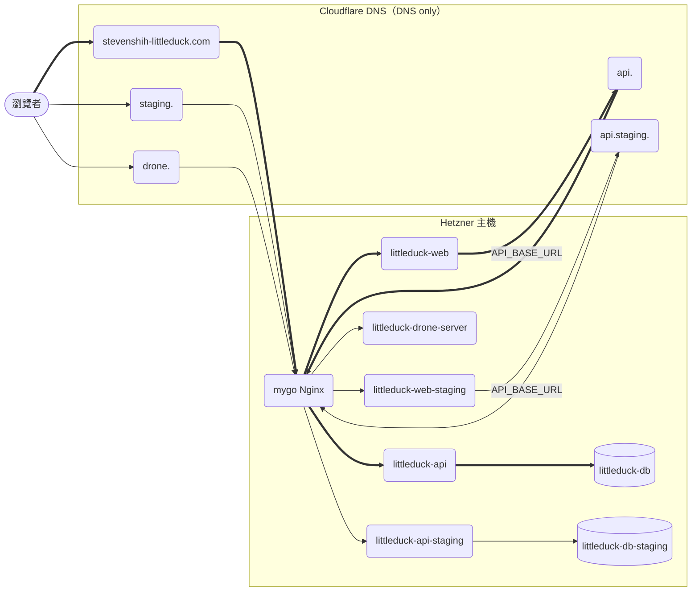
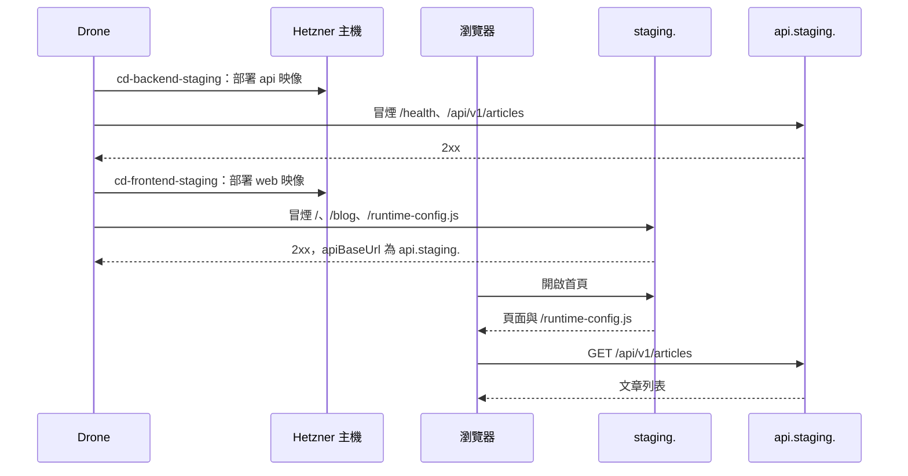

# Design

## Context

動機見 proposal.md（Why）。以下依最新 `main`（SDP-157 前端自架、SDP-164 Node 24 已合併）的實際檔案分析：

- **前端已自架**：`.drone.yml` 的 `cd-frontend-staging`／`cd-frontend-production` 建置 `littleduck-web` 映像、推 GHCR、部署到主機 `/opt/littleduck-web-staging`／`/opt/littleduck-web`，經 mygo Nginx 的 `/opt/edge-sites/` 對外。前端呼叫的後端位址由主機 `.env` 的 `API_BASE_URL` 在執行期經 `/runtime-config.js` 交給瀏覽器，同一映像在兩個環境打不同後端。repo 內已沒有任何 Vercel 設定（`frontend-delivery` 規格以 `grep -i vercel` 守住）。
- **主機名只出現在文件、註解與 Drone secret 的值**。`.drone.yml` 一律以 `from_secret`（`api_host`、`api_staging_host`、`frontend_host`、`frontend_staging_host`）帶入；`deploy/edge/render.sh` 用 `envsubst` 把 `${API_STAGING_HOST}` 等變數帶進 `server_name` 與 `/etc/letsencrypt/live/<host>/` 憑證路徑。後端 Staging 從 `api-staging.<網域>` 改成 `api.staging.stevenshih-littleduck.com`（多一層子網域）不需改樣板、腳本或 `.drone.yml`。
- `api-staging`、`web-staging` 在 repo 內是**環境名稱**（樣板檔名、`littleduck-api-staging` 容器、`/opt/littleduck-api-staging` 目錄、`backend-bundle.sh` 的 `site=api-staging`），不是主機名，維持不變。
- **剩下的佔位**（`git grep` 結果）：
  - `docs/deployment-runbook.md`：開頭說明、第 0 節 DNS、第 1 節（OAuth URL、certbot、render、登入驗證）、第 2 節環境表與憑證、第 3 節前端 `.env` 的 `API_BASE_URL`、第 5 節後端 Staging 檢查、第 6 節後端回滾，共約 16 處。其中第 3 節前端 `.env` 引用後端佔位，user 照抄會讓 `cd-frontend-staging` 的 runtime-config 冒煙失敗。
  - `docs/cicd.md`：後端 CD 冒煙目標 `https://<staging>`、`https://<production>`；Secret 清單只有用途沒有值。
  - `deploy/drone/.env.example`、`deploy/ci/smoke-backend.sh`、`deploy/ci/smoke-frontend.sh`：註解範例用 `example.com`／`api-staging.example.com`。
  - `openspec/specs/ci-server`、`backend-delivery` 場景用 `<網域>`；`frontend-delivery` 場景用 `<前端 Staging 主機名>`、「正式網域」。
- DNS 託管在 Cloudflare。`staging.stevenshih-littleduck.com` 曾是 mygo 舊 Staging 的主機名，SDP-157 已在 runbook 第 3 節寫好清理步驟；`mygo.staging.` 與本專案的 `api.staging.` 不衝突。
- 後端 CORS 目前 `Access-Control-Allow-Origin: *`（`backend/internal/middleware/middleware.go`），兩個前端主機名都能呼叫。

## Goals / Non-Goals

**Goals:**
- user 照 runbook 從頭架設時，所有主機名、DNS 記錄、`.env` 值與主機名類 secret 的值都能直接複製，repo 的文件與部署註解不再有 `<網域>`、`<staging>`、`<production>`、`example.com` 佔位。
- `docs/cicd.md` 有「各階段耗時」紀錄表的位置（SDP-113 6.1）。
- 規格場景寫出實際主機名，作為 user 實機驗收的依據。

**Non-Goals:**（另見 proposal.md Non-goals）
- 不改 `.drone.yml`、Nginx 樣板、bundle／deploy 腳本與 compose 檔的邏輯。
- 不把主機名寫死進 `.drone.yml`。
- 不收斂 CORS、不改任何 API、不動 `backend/`、`frontend/`。

## Decisions

### D1：主機名維持由 secret 傳入，文件記錄實際值

替代方案是在 `.drone.yml` 寫死主機名。不採用：SDP-113／SDP-157 的設計把主機名當設定值，寫死會讓換網域要改 CI 設定（高風險檔），也和 mygo 的做法不一致。改為在 `docs/cicd.md` 的 Secret 清單加一欄「值」，user 建 secret 時照抄：

| secret | 值 |
|--------|----|
| `api_host` | `api.stevenshih-littleduck.com` |
| `api_staging_host` | `api.staging.stevenshih-littleduck.com` |
| `frontend_host` | `stevenshih-littleduck.com` |
| `frontend_staging_host` | `staging.stevenshih-littleduck.com` |
| `hetzner_host` | 主機 IP（不寫進 repo，見 mygo_v2_anon 的 runbook） |
| `deploy_ssh_key` | runbook 第 2 節產生的 `drone_deploy` 私鑰內容 |
| `ghcr_username`、`ghcr_token` | GitHub 帳號與具 `write:packages` 的 PAT |

repo 是 public，主機 IP 不寫進文件。

### D2：後端 Staging 用 `api.staging.`，樣板與腳本不動

`render.sh` 只驗證變數有設定再 `envsubst`，與主機名層數無關；certbot 以 `-d api.staging.stevenshih-littleduck.com` 核發後，`live/` 目錄名就是主機名，與樣板的憑證路徑一致。HTTP-01 逐一核發即可，不需要萬用憑證。runbook 第 2 節的憑證指令從有歧義的 `-d <網域>` 改成兩行明確指令。

### D3：Drone 主機名預填在 `.env.example`

`DRONE_SERVER_HOST` 不是祕密，且只有一個值，直接在 `deploy/drone/.env.example` 預填 `drone.stevenshih-littleduck.com`，user 複製成 `.env` 時少填一項。OAuth App 的 Homepage／Callback URL 註解同步改成實際網址。

### D4：DNS 前置集中列出

runbook 第 0 節的 DNS 列改為三筆 A 記錄（`drone.`、`api.`、`api.staging.` 指向主機 IP），並註明 Cloudflare 代理狀態設 DNS only（灰雲），理由同第 3 節前端 DNS：HTTP-01 驗證與憑證續約需要直連。前端兩筆（apex、`staging.`）維持在第 3 節，第 0 節以連結指向。

### D5：「各階段耗時」只放空表

`docs/cicd.md` 文末新增「## 各階段耗時」，說明由 user 實機量測後填寫。表格欄位為「階段／起點→終點／耗時／量測日期」，列：

| 階段 | 起點→終點 |
|------|-----------|
| PR CI | PR 開啟 → `continuous-integration/drone/pr` 成功 |
| 後端 Staging | 合併 → `cd-backend-staging` 完成 |
| 前端 Staging | 合併 → `cd-frontend-staging` 完成 |
| 後端 Production | promote → `cd-backend-production` 完成 |
| 前端 Production | promote → `cd-frontend-production` 完成 |
| 全程 | PR 開啟 → Production 冒煙通過 |

耗時欄寫「待量測」，不由 Agent 估計。

### 資料流

- 五個主機名都是 A 記錄指向同一台主機，由 mygo Nginx 依 `server_name` 分流；站台設定由 `deploy/edge/*.conf.template` 渲染後放在 `/opt/edge-sites/`（SDP-114）。
- 前端容器只把 `API_BASE_URL` 經 `/runtime-config.js` 交給瀏覽器，實際的 API 請求由瀏覽器直接發往後端主機名，所以箭頭從前端容器指向後端的 DNS 記錄。
- 本次只把圖中各主機名落實到文件與註解，資料流本身與 SDP-157 合併後相同。
- 依據：`deploy/edge/*.conf.template`、`deploy/edge/render.sh`、`deploy/web/docker-compose.*.yml`、`backend/docker-compose.*.yml`、`.drone.yml`、`frontend/lib/runtime-config.mjs`。

### 前後端互動時序（合併到 main 後的 Staging）

- 圖中 `staging.` 指 `https://staging.stevenshih-littleduck.com`，`api.staging.` 指 `https://api.staging.stevenshih-littleduck.com`。冒煙的主機名來自 secret `frontend_staging_host`、`api_staging_host`，即 D1 表中的值。
- 兩條 CD pipeline 各自依賴自己的 CI，彼此不互等；圖中先後只為閱讀方便。
- Production 的時序相同，只是由 promote 觸發、主機名換成 apex 與 `api.`。
- 依據：`.drone.yml` 的 `cd-backend-staging`、`cd-frontend-staging`，`deploy/ci/smoke-backend.sh`、`deploy/ci/smoke-frontend.sh`。

## Risks / Trade-offs

- [前端 `.env` 照抄舊佔位] → 本次把第 3 節 `API_BASE_URL` 改成實際值，`cd-frontend-staging` 的 runtime-config 冒煙也會擋下設錯的值。
- [`api.staging.` DNS 或憑證未就緒就跑第一次 CD] → runbook 原本已要求憑證在第一次 CD 之前完成；`install-sites.sh` 找不到憑證時不放站台，mygo 不受影響。
- [Cloudflare 開了代理（橘雲）] → 第 0 節明寫 DNS only。
- [`deploy/**` 屬高風險檔案] → 雖只改註解與範本值，整個變更仍判為高風險，PR 中等 user 回覆「合併」。
- [開發 Agent 寫入範圍] → 全部檔案在 `backend/` 之外；依 user 決定由主對話暫時放寬「後端子目錄」（見 handoff.md）。

## Migration Plan

1. 合併本變更（文件、註解、規格）。CD 行為不變。
2. user 照更新後的 runbook 做 DNS、憑證、Drone、主機、secret 架設。
3. user 依 `handoff.md`「上線後由 user 手動驗收」清單逐項驗收，並把耗時填入 `docs/cicd.md`、記憶體量測填入 runbook。

**回滾**：還原本次 commit 即可，不影響任何執行中的服務。

## 執行驗證觀察點

本次不動執行期程式碼，產品跑起來的行為不變（`CLAUDE.md` 的通用觀察點照跑即可）。以下為不需外部環境、在 worktree 根目錄直接執行的指令：

- `git grep -nE '<網域>|<staging>|<production>|example\.com' -- docs/deployment-runbook.md docs/cicd.md deploy/` → 無輸出
- `git grep -nE 'api-staging\.(<|example|stevenshih)' -- docs deploy openspec/specs openspec/changes/sdp-117-cicd-rollout/specs` → 無輸出（`api-staging` 作為環境名稱，如 `api-staging.conf.template`、`littleduck-api-staging`，不在比對範圍）
- `git grep -c 'api\.staging\.stevenshih-littleduck\.com' -- docs/deployment-runbook.md` → 數字至少 `5`
- `git grep -il vercel -- .drone.yml deploy docs frontend README.md .gitignore CLAUDE.md` → 無輸出（SDP-157 的規格不可被本次破壞）
- `grep -n '^## 各階段耗時' docs/cicd.md` → 恰好一行
- `grep -c '^DRONE_SERVER_HOST=drone\.stevenshih-littleduck\.com$' deploy/drone/.env.example` → `1`
- `sh -n deploy/ci/smoke-backend.sh && sh -n deploy/ci/smoke-frontend.sh && echo ok` → `ok`
- `d=$(mktemp -d) && API_STAGING_HOST=api.staging.stevenshih-littleduck.com sh deploy/edge/render.sh "$d" api-staging >/dev/null && grep -cE 'server_name api\.staging\.stevenshih-littleduck\.com;|live/api\.staging\.stevenshih-littleduck\.com/' "$d/littleduck-api-staging.conf"; rm -rf "$d"` → `4`（兩個 `server_name` 與兩條憑證路徑，證明兩層子網域可直接渲染）

實機上線後的觀察（`https://drone.…` 登入頁、Staging／Production 冒煙等）由 user 手動驗收，不列在此。

## 變異測試目標

無。本次只改文件、部署腳本的註解與 `.env.example` 的範本值，沒有任何可執行邏輯變動，也沒有權限、狀態機等關鍵模組。
