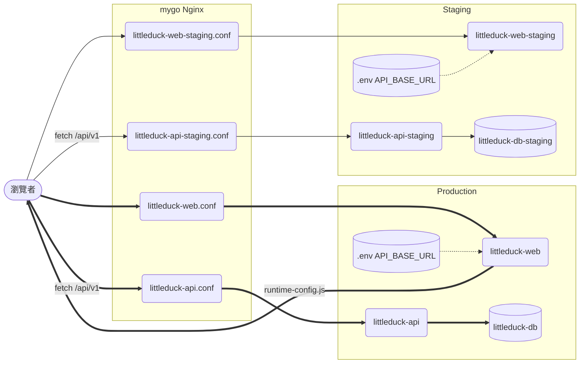
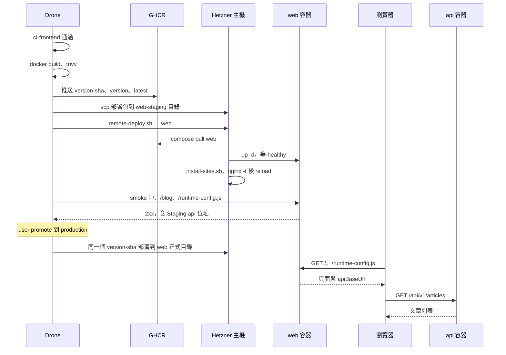

# Design

## Context

動機見 proposal.md（Why）。現況與限制：

- **前端全部在瀏覽器端取資料**：頁面都是 `"use client"`，`frontend/lib/api.js` 在模組載入時讀 `process.env.NEXT_PUBLIC_API_BASE_URL`（未設定退回 `http://localhost:8080`）。`NEXT_PUBLIC_` 變數在 `next build` 時被寫進 client bundle，**建置後就改不了**。
- **後端的部署模型是「建一次、promote 同一個映像」**：`cd-backend-staging` 建出 `<version>-<sha>` 映像推 GHCR，`cd-backend-production` 不重建，直接部署同一個 tag（`deploy/ci/image-ref.sh`、`remote-deploy.sh`）。前端要跟後端一致，Staging 與 Production 必須共用映像，所以 API 位址不能在建置時寫死。
- **主機**：mygo 的 Nginx 佔 80／443，以 `/opt/edge-sites/*.conf` 載入外部站台（SDP-114，已完成）。站台樣板在 `deploy/edge/*.conf.template`，由 `render.sh` 以 `envsubst` 帶入網域，`install-sites.sh` 先查憑證、`nginx -t` 失敗就還原。upstream 以容器名在 `mygo-edge` 網路上解析，容器名一律 `littleduck-` 前綴。
- **Drone runner `DRONE_RUNNER_CAPACITY: "1"`**（`deploy/drone/docker-compose.yml`）：同一時間只跑一個 pipeline，前後端 CD 不會同時呼叫 `install-sites.sh`，不需要另加鎖。
- **後端 CORS 為 `*`**：新前端主機名可直接呼叫後端，不改後端。
- **主機資源**：CX23（2 vCPU／4 GB RAM）。repo 內已設的記憶體上限：後端正式 api 256M＋db 512M、Staging api 128M＋db 256M、Drone server 256M＋runner 128M，合計 1536M；mygo 的用量不在本 repo。`next build` 也在同一台的 runner 上執行（`ci-frontend` 已經在跑）。
- `next/font/google` 在建置時下載字型，Docker 建置需要對外網路（Drone runner 有）。

## Goals / Non-Goals

**Goals:**
- 同一個前端映像能在 Staging 驗證後 promote 到 Production，兩個環境各自打對應的後端。
- 前端的 CD 階段、映像 tag、部署腳本、回滾方式與後端對齊。
- repo 內（`.drone.yml`、`deploy/`、`docs/`、`frontend/`、根目錄 `README.md`、`.gitignore`、`CLAUDE.md`）不再有 Vercel 的部署步驟或設定。

**Non-Goals:**（另見 proposal.md Non-goals）
- 不改前端頁面與資料流，只改 API 位址的取得方式。
- 不改後端程式碼、`backend/docker-compose*.yml`、`backend-bundle.sh` 的行為。
- 不在 repo 內寫死主機名：仍由 Drone secret 與主機 `.env` 傳入。

## Decisions

### D1：standalone 輸出＋`frontend/Dockerfile`

`next.config.mjs` 加 `output: "standalone"`。`frontend/Dockerfile` 三段式：

1. `deps`：`node:20-alpine`，`npm ci`；
2. `build`：`NEXT_TELEMETRY_DISABLED=1`，`npm run build`；**不帶** `NEXT_PUBLIC_API_BASE_URL`；
3. `runner`：`node:20-alpine`，只複製 `.next/standalone`、`.next/static`、`public`，`USER node`，`ENV NODE_ENV=production HOSTNAME=0.0.0.0 PORT=3000`，`EXPOSE 3000`，`CMD ["node", "server.js"]`。

另加 `frontend/.dockerignore`（`node_modules`、`.next`、`.env*` 但保留 `.env.example`、`*.log`）與 `frontend/.trivyignore`（只有說明註解，規則同 `backend/.trivyignore`）。

替代方案：`next export` 靜態輸出交給 Nginx 直接提供。不採用：`/blog/[id]` 是動態路由，靜態輸出要 `generateStaticParams` 預先列舉文章，且無法在執行期注入 API 位址。

Dockerfile 放 `frontend/`（與 `backend/Dockerfile` 對稱，`docker build frontend` 即可），歸前端 Agent。

### D2：API 位址在執行期注入（`/runtime-config.js`）

issue 要確認的問題：`NEXT_PUBLIC_API_BASE_URL` 是 build time 寫死。結論是**改成 runtime 決定**，理由見 Context 第 2 點。

做法：

- `frontend/lib/runtime-config.mjs`（純函式，可用 `node --test` 測）：
  - `normalizeApiBaseUrl(value)`：去頭尾空白與結尾 `/`；只接受 `http:`／`https:` 的絕對 URL，其他（空字串、相對路徑、`javascript:` 等）回 `null`。
  - `renderRuntimeConfigScript(apiBaseUrl)`：回傳 `window.__LD_RUNTIME_CONFIG__=<JSON>;`，JSON 內的 `<`、`>`、`&`、U+2028、U+2029 轉成 `\uXXXX`，避免值被當成 HTML／腳本結構。
  - `resolveApiBaseUrl(runtimeValue, buildValue)`：依序取 `normalizeApiBaseUrl(runtimeValue)`、`normalizeApiBaseUrl(buildValue)`，都沒有時 `http://localhost:8080`。
- `frontend/app/runtime-config.js/route.js`：`GET` 讀 `process.env.API_BASE_URL`，回 `renderRuntimeConfigScript(normalizeApiBaseUrl(...))`，`Content-Type: text/javascript; charset=utf-8`、`Cache-Control: no-store`；`export const dynamic = "force-dynamic"`，確保不在建置時被預先算好。
- `frontend/app/layout.jsx`：以 `next/script` 的 `<Script src="/runtime-config.js" strategy="beforeInteractive" />` 載入，在 hydration 前執行。
- `frontend/lib/api.js`：拿掉模組層級的 `BASE_URL` 常數，`request()` 每次以 `resolveApiBaseUrl(window.__LD_RUNTIME_CONFIG__?.apiBaseUrl, process.env.NEXT_PUBLIC_API_BASE_URL)` 取位址（server 端沒有 `window` 時只看建置值）。
- 環境變數名用 `API_BASE_URL`（沒有 `NEXT_PUBLIC_` 前綴），才不會被建置時內嵌。`NEXT_PUBLIC_API_BASE_URL` 保留為本機開發的後備，`.env.example` 寫明兩者的差別與優先序。

替代方案：

| 方案 | 不採用的理由 |
|------|-------------|
| Staging、Production 各建一個映像（build arg 帶入位址） | promote 到 Production 的不是 Staging 驗證過的那個映像，與後端模型不一致 |
| root layout 在 server 端直接輸出 inline script | 要讓所有頁面改成動態渲染，失去靜態最佳化；也較難單元測試 |
| 依 `location.host` 推算後端主機名 | 把網域規則寫死在前端，換網域要改程式 |
| 由前端 Nginx 反向代理 `/api` 到後端 | 改變瀏覽器呼叫的主機名與 CORS 行為，也讓 Nginx 樣板依賴後端容器 |

若 ESLint 的 `@next/next/no-before-interactive-script-outside-document` 對 root layout 報錯，依 `CLAUDE.md` 以帶理由的單行註解豁免（App Router 的 root layout 是官方允許的位置），不改規則。

### D3：部署形態與命名

| 項目 | Staging | Production |
|------|---------|-----------|
| 主機名（secret） | `frontend_staging_host` = `staging.stevenshih-littleduck.com` | `frontend_host` = `stevenshih-littleduck.com` |
| 主機目錄 | `/opt/littleduck-web-staging` | `/opt/littleduck-web` |
| compose 檔（repo） | `deploy/web/docker-compose.staging.yml` | `deploy/web/docker-compose.prod.yml` |
| compose project／容器 | `littleduck-web-staging` | `littleduck-web` |
| Nginx 樣板 | `deploy/edge/web-staging.conf.template` | `deploy/edge/web.conf.template` |
| 主機 `.env` | `API_BASE_URL=https://<後端 Staging 主機名>` | `API_BASE_URL=https://<後端正式主機名>` |
| 記憶體上限 | 192M（`NODE_OPTIONS=--max-old-space-size=128`） | 256M（`--max-old-space-size=192`） |

- 映像：`ghcr.io/stevenshih-0402/littleduck-web`，tag 同後端：`<version>-<git 短 sha>`、`<version>`、`latest`；`<version>` 取 `frontend/package.json` 的 `version`（`deploy/ci/frontend-version.sh`，用 `sed` 讀，不依賴 `jq`／`node`）。
- compose：服務名 `web`，`image: ${LITTLEDUCK_WEB_IMAGE:?…}`，`env_file: .env`，只接 `default` 與外部網路 `mygo-edge`，**不開埠**；healthcheck 用 busybox `wget -q -O /dev/null http://127.0.0.1:3000/runtime-config.js`，interval 10s、start_period 15s。
- 主機 `.env` 只放 `API_BASE_URL`，由 user 依 runbook 手動放置，與後端一致；`remote-deploy.sh` 原本就會檢查 `.env` 存在。
- Nginx 樣板：結構同 `api.conf.template`（80 轉 443、ACME webroot、`resolver 127.0.0.11`、以變數 upstream `littleduck-web:3000`／`littleduck-web-staging:3000`、轉送 `Host`、`X-Forwarded-*`），不設 `client_max_body_size`（前端站台沒有上傳）。

### D4：腳本參數化，後端呼叫不變

| 腳本 | 改動 |
|------|------|
| `image-ref.sh` | 第 1 個參數 `backend`（預設）或 `frontend`；`frontend` 時 repo 預設 `ghcr.io/stevenshih-0402/littleduck-web`（`LITTLEDUCK_WEB_IMAGE_REPO` 可覆寫）、版本取 `frontend-version.sh`。無參數時輸出與現在完全相同 |
| `remote-deploy.sh` | 選填第 4 個參數 `<service>`（預設 `api`）：映像環境變數名為 `LITTLEDUCK_<SERVICE 大寫>_IMAGE`（`api` → `LITTLEDUCK_API_IMAGE`、`web` → `LITTLEDUCK_WEB_IMAGE`），`pull`／`logs` 對該服務 |
| `frontend-bundle.sh`（新） | `<staging|production>`：組 `bundle/`＝對應 compose 檔、`install-sites.sh`、`remote-deploy.sh`、`image.txt`、`render.sh` 渲染的 `littleduck-web(-staging).conf` |
| `smoke-frontend.sh`（新） | `<前端 base URL> <預期 API base URL>`：`/`、`/blog` 回 2xx，且 `/runtime-config.js` 內容含預期的 API 位址；任一不符即失敗。重試方式同 `smoke-backend.sh` |
| `vercel-deploy.sh` | 刪除 |
| `render.sh` | 只更新用法註解的變數清單 |

替代方案：把 `backend-bundle.sh` 改成通用的 `bundle.sh <component> <env>`。不採用：會動到已上線的後端 CD 路徑，前端多一支小腳本的重複成本較低。

### D5：`.drone.yml`

- `ci-frontend`：在 `audit` 之後加 `docker-build`（`docker build -t littleduck-web:ci-${DRONE_BUILD_NUMBER} frontend`）、`trivy`（`--ignorefile frontend/.trivyignore`）、`cleanup`（不論成敗），volumes 同 `ci-backend`。PR 上就能抓到 Dockerfile 壞掉，不必等合併後的 CD。
- `cd-frontend-preview` 改名 `cd-frontend-staging`，`depends_on: ci-frontend`，階段與 `cd-backend-staging` 相同：`build`（`image-ref.sh frontend`）→ `trivy` → `push-ghcr` → `bundle`（`FRONTEND_STAGING_HOST`）→ `upload`（`/opt/littleduck-web-staging`）→ `deploy`（`remote-deploy.sh /opt/littleduck-web-staging docker-compose.staging.yml littleduck-web-staging web`）→ `smoke`（`smoke-frontend.sh "https://$$FRONTEND_STAGING_HOST" "https://$$API_STAGING_HOST"`）→ `cleanup`。
- `cd-frontend-production`：`verify-build` → `bundle`（`image-ref.sh frontend` 產生同一個 tag，`FRONTEND_HOST`）→ `upload`（`/opt/littleduck-web`）→ `deploy`（`… littleduck-web web`）→ `smoke`（`FRONTEND_HOST`、`API_HOST`）。不重新建置。
- 移除所有 `vercel_*` secret 引用；新增 `frontend_staging_host`。

### D6：主機記憶體評估寫進 runbook

repo 內能確定的只有上限：前端兩個容器合計 448M，littleduck 全部容器上限合計約 2 GB。mygo 實際用量要在主機上看，所以 runbook 的「前端主機初次建置」第一步是：

1. `free -m` 與 `docker stats --no-stream` 記下目前用量；
2. 判準：`available` 減去 448M 後仍 ≥ 1024M（保留給 `ci-frontend`／`cd-frontend-staging` 的 `next build` 與 `docker build` 尖峰）；
3. 不足時先調低 Staging 上限或加 swap，再往下做；把量測結果記在 runbook 的紀錄表（數值由 user 填）。

### 資料流

- 瀏覽者先從前端站台拿到頁面與 `/runtime-config.js`，之後由瀏覽器直接呼叫 `runtime-config.js` 指定的後端主機名。
- 前端容器沒有連到後端容器；`.env` 只決定交給瀏覽器的位址。
- 依據：`frontend/lib/api.js`、`deploy/edge/api.conf.template`、`deploy/ci/remote-deploy.sh`、`backend/docker-compose.prod.yml`。

### CD 時序（推送到 main → Staging → promote）

- 健康逾時 120 秒（沿用 `remote-deploy.sh` 的 `HEALTH_TIMEOUT`），逾時即 CD 失敗，不開放 promote。
- `cd-frontend-production` 的 `verify-build` 先確認該 commit 的 push 建置全綠，與後端相同。
- 依據：`.drone.yml` 的 `cd-backend-staging`／`cd-backend-production`、`deploy/ci/remote-deploy.sh`、`deploy/edge/install-sites.sh`。

## Risks / Trade-offs

- [`/runtime-config.js` 載入失敗或未設 `API_BASE_URL`] → 前端退回建置值或 `localhost:8080`，頁面取不到資料；CD 冒煙檢查 `runtime-config.js` 必須含預期位址，設錯會讓 CD 失敗而不是靜默上線。
- [`beforeInteractive` 多一個阻塞請求] → 回應只有幾十 bytes、同源，影響可忽略；`no-store` 確保換 `.env` 後立即生效。
- [CX23 記憶體不足] → D6 的量測與判準；容器設上限與 `--max-old-space-size`，OOM 只殺前端容器，不拖垮 mygo。
- [Docker 建置在 runner 上再跑一次 `next build`，CI 時間與記憶體尖峰增加] → runner capacity 1 序列執行；可接受。
- [`staging.stevenshih-littleduck.com` 是 mygo 舊 Staging 主機名，主機上可能殘留 A 記錄與 certbot 續約設定] → runbook 寫明先確認 mygo 已不使用、`certbot delete --cert-name staging.stevenshih-littleduck.com`，再重新核發。
- [apex 網域的 DNS 原本可能指向 Vercel 或有轉址規則] → runbook DNS 前置列出 apex 與 `staging.` 要改成 A 記錄指向主機、Cloudflare 設 DNS only。
- [`.drone.yml`、`deploy/**`、`**/Dockerfile` 屬高風險檔案] → 整個變更高風險，PR 中等 user 回覆「合併」。
- [後端 Agent 寫入範圍] → 主 repo `CLAUDE.md` 已暫時放寬到 `deploy/`、`docs/`、`.drone.yml`、`README.md`、`.gitignore`、`CLAUDE.md`，合併後改回；worktree 的 `CLAUDE.md` 只移除高風險樣式中的 `frontend/vercel.json`，放寬不進 PR。

## Migration Plan

1. 合併本變更。合併後第一次推送 `main` 會跑 `cd-frontend-staging`；主機尚未設定時會在 `deploy`（缺 `.env`）或 `install-sites.sh`（缺憑證）失敗，**不影響後端 CD 與 mygo**。
2. user 照 runbook：量測記憶體 → DNS（apex、`staging.` 改 A 記錄）→ 清理舊 `staging.` 憑證 → certbot 核發 → 建 `/opt/littleduck-web*` 與 `.env` → 建 `frontend_staging_host` secret、刪 `vercel_*` secret → 重跑建置。
3. Staging 通過後 promote，Production 冒煙通過即完成切換；最後刪除 Vercel 專案。

**回滾**：
- 某次前端版本有問題：同後端，在主機上把 `image.txt` 換成前一個 `<version>-<sha>` 後 `docker compose up -d`，或在 Drone 對前一個良好建置重新 promote。
- 自架整體不可行：還原本次 commit 並把 DNS 指回 Vercel（Vercel 專案在步驟 3 之前保留）。

## 執行驗證觀察點

以下指令在 worktree 根目錄執行；`CLAUDE.md` 的通用啟動（後端 18080、前端 `next start` 3100）要先跑起來。映像以 3101 埠另外啟動，不與 3100 衝突。

- `curl -s localhost:3100/runtime-config.js` → `window.__LD_RUNTIME_CONFIG__={"apiBaseUrl":null};`（通用啟動沒設 `API_BASE_URL`）
- `docker build -q -t ld-web-check frontend >/dev/null && docker run -d --rm --name ld-web-check -p 3101:3000 -e API_BASE_URL=http://localhost:18080 ld-web-check >/dev/null && sleep 5 && curl -s -o /dev/null -w '%{http_code}' localhost:3101/` → `200`
- `curl -s localhost:3101/runtime-config.js` → `window.__LD_RUNTIME_CONFIG__={"apiBaseUrl":"http://localhost:18080"};`
- `curl -s -o /dev/null -w '%{http_code}' localhost:3101/blog/a1` → `200`
- `docker inspect -f '{{.Config.User}}' ld-web-check` → `node`
- `sh deploy/ci/smoke-frontend.sh http://localhost:3101 http://localhost:18080; echo "exit=$?"` → 印出三個「通過」且 `exit=0`
- `sh deploy/ci/smoke-frontend.sh http://localhost:3101 https://api.example.invalid; echo "exit=$?"` → `runtime-config.js` 那一項失敗且 `exit=1`
- `docker stop ld-web-check >/dev/null && docker image rm ld-web-check >/dev/null && echo stopped` → `stopped`（收尾，必跑）
- `for f in deploy/ci/*.sh deploy/edge/*.sh; do sh -n "$f" || echo "語法錯誤 $f"; done; echo done` → 只印 `done`
- `sh deploy/ci/image-ref.sh` → 與 `origin/main` 上同一指令的輸出格式相同：`ghcr.io/stevenshih-0402/littleduck-api:0.1.0-<7 碼 sha>`
- `sh deploy/ci/image-ref.sh frontend` → `ghcr.io/stevenshih-0402/littleduck-web:2.0.0-<7 碼 sha>`
- `FRONTEND_HOST=stevenshih-littleduck.com FRONTEND_STAGING_HOST=staging.stevenshih-littleduck.com sh deploy/edge/render.sh /tmp/ld-sdp157-sites web web-staging >/dev/null && grep -hcE 'server_name (staging\.)?stevenshih-littleduck\.com;' /tmp/ld-sdp157-sites/littleduck-web.conf /tmp/ld-sdp157-sites/littleduck-web-staging.conf` → 兩行各為 `2`
- `grep -rIil vercel .drone.yml deploy docs frontend README.md .gitignore CLAUDE.md --exclude-dir=node_modules --exclude-dir=.next` → 無輸出
- `docker run --rm -v "$PWD:/w" -w /w drone/cli:1.8.0 lint --trusted .drone.yml && echo ok` → `ok`

## 變異測試目標

- `frontend/lib/runtime-config.mjs`：URL 正規化（只接受 http／https）、腳本跳脫、優先序 fallback。錯了會讓前端打錯後端或產生可注入的腳本內容。對應任務 4.2。

其餘為部署腳本與設定檔，無法以單元測試的變異測試涵蓋，以 CD 冒煙與上方觀察點驗證。
