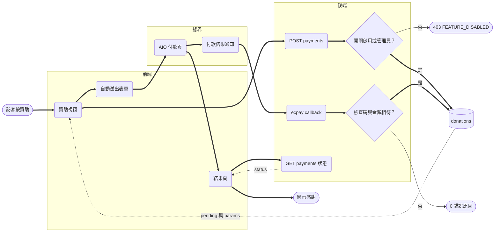
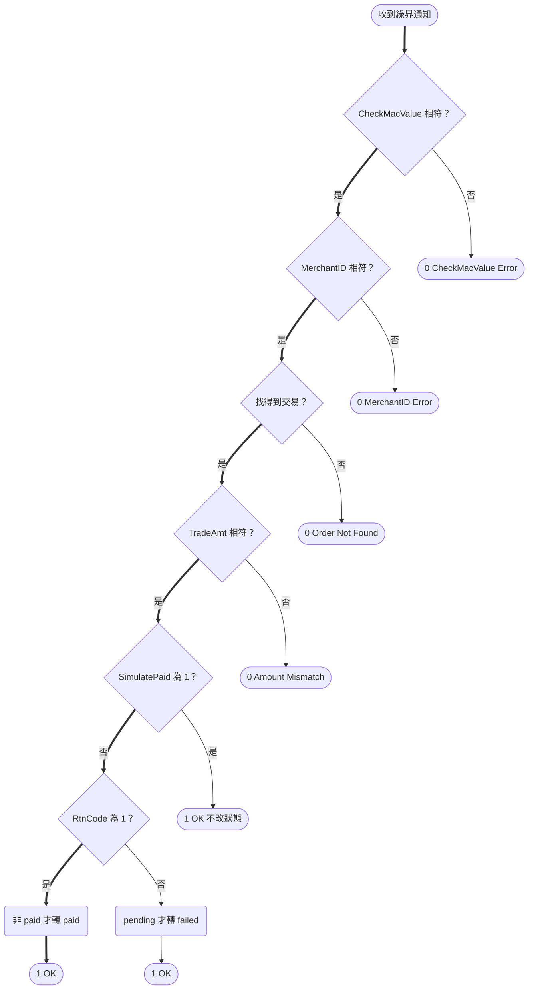
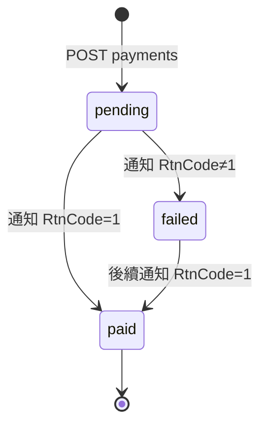
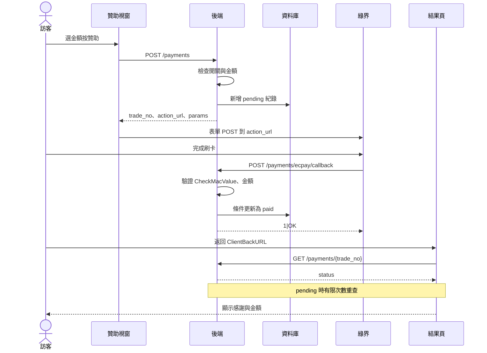

# Design：贊助流程串接綠界 ECPay（SDP-104）

## Context

動機見 proposal.md「Why」。現況與限制：

- 後端 `internal/service/payment/` 只有 `PaymentProvider` interface 與回 501 的 `ECPayService` 骨架；`CreatePaymentResult` 只有 `PaymentURL`，不夠用——綠界 AIO 規定由**前端表單 POST** 導向（`/Cashier/AioCheckOut/V5`），不是 GET 轉址。
- `Donation` model 以字串 id（seed 的 `d1`…）為主鍵，沒有狀態欄位；`GET /api/v1/donations` 由後台唯讀使用。
- 功能開關已有 `sponsor`（預設啟用，控制贊助浮動按鈕）。SDP-149 規則要求新功能預設停用，並在公開寫入端點停用時回 403、管理員 JWT 放行；`comment_service.go` 的 `ensureEnabled` 是既有範本。
- 錯誤一律經 `apperror` 與 error handler 輸出統一 envelope；但綠界的通知要求回應**純文字** `1|OK`，callback 不能走 envelope。
- 前端以 `lib/api.js` 的 `apiPost` 呼叫後端（`fetch`，會自動附帶 sessionStorage 中的管理員 token，所以管理員預覽天然成立）。
- 本機與 Teshima 的執行驗證都用 `backend/docker-compose.yml`，其中 `ECPAY_*` 目前是空字串。

## Goals / Non-Goals

**Goals：**

- 一般瀏覽者能從贊助視窗完成綠界付款，付款結果以綠界的 server-to-server 通知為準寫回資料庫。
- 通知處理防偽造（CheckMacValue、MerchantID、金額三重比對）、可重複通知（冪等）、已付款不會被改回失敗。
- 依 SDP-149 規則以 `sponsor_payment` 開關控制上線時機。

**Non-Goals：**

- 退款、定期定額、電子發票、`PaymentInfoURL`（ATM／超商代碼的取號通知）與主動查詢綠界訂單（QueryTradeInfo）的對帳排程。
- 前台贊助者名稱輸入欄（設計稿沒有；`name` 欄位先保留在 API，前端不送，後端記為「匿名訪客」）。
- 收斂 CORS 白名單、後台「本月贊助」寫死 7 月等既有問題。
- 清除 `pending` 逾時紀錄（綠界訂單本身有效期限，pending 留在資料庫不影響統計）。

## Decisions

### D1. 回傳表單欄位，由前端自動送出

`POST /api/v1/payments` 回 `{trade_no, action_url, params}`，前端用 DOM 建立隱藏 `<form method="post">` 後 `submit()`。
**替代方案**：後端回一段自動送出的 HTML 讓前端塞進頁面——混入 HTML 字串有 XSS 面、也不符合既有 JSON envelope，捨棄。

### D2. CheckMacValue 獨立成純函式

新增 `internal/service/payment/checkmac.go`：參數依 key 不分大小寫排序 → 前後加 `HashKey=`／`HashIV=` → 綠界規定的 .NET 風格 URL encode（再轉小寫，並把 `%2d %5f %2e %21 %2a %28 %29` 還原為 `- _ . ! * ( )`、空白為 `+`）→ SHA256 → 轉大寫。比對時不分大小寫、使用常數時間比較。單元測試 MUST 使用綠界官方文件提供的範例參數與期望值，不可只做自我一致性測試。
`ECPayService.CreatePayment` 產生 `params`：`MerchantID`、`MerchantTradeNo`、`MerchantTradeDate`（`yyyy/MM/dd HH:mm:ss`，UTC+8）、`PaymentType=aio`、`TotalAmount`、`TradeDesc`、`ItemName`、`ReturnURL`、`ClientBackURL`、`ChoosePayment`、`EncryptType=1`、`CheckMacValue`。`ChoosePayment` 固定為 `Credit`（user 決定只開信用卡，2026-11-17）。

### D3. 業務協調放在 `service/payment_service.go`

`internal/service/payment/` 維持「金流商適配層」（不碰資料庫），新增 `internal/service/payment_service.go`（package `service`）負責：輸入驗證、功能開關（注入 `FeatureChecker`）、交易編號產生、寫 `Donation`、處理通知的狀態轉換、狀態查詢。controller 只做 HTTP 轉換。
**替代方案**：直接在 `ECPayService` 裡存資料庫——金流商與業務混在一起、測試要接 DB，捨棄。

### D4. 交易編號即 Donation 主鍵

`MerchantTradeNo` 格式 `LD` + `yyMMddHHmmss`（UTC+8）+ 6 碼隨機英數（共 20 碼，符合綠界上限 20 碼英數），用 `crypto/rand`。直接當 `Donation.ID`，不另開欄位；碰撞時（主鍵衝突）重產一次。seed 的 `d1`… 不受影響。

### D5. 狀態欄位與冪等轉換

`Donation` 新增 `Status`（`size:16;not null;default:paid`）、`PaidAt *time.Time`、`EcpayTradeNo`（`size:32`）、`PaymentType`（`size:32`）。`default:paid` 讓 AutoMigrate 為既有列補值（PostgreSQL `ADD COLUMN ... DEFAULT` 會回填）；新建付款明確寫 `pending`。
狀態轉換以**條件更新**完成，避免綠界重送與並行造成覆寫：
- 轉 `paid`：`UPDATE ... SET status='paid', paid_at=?, ... WHERE id=? AND status<>'paid'`；
- 轉 `failed`：`UPDATE ... SET status='failed' WHERE id=? AND status='pending'`。
影響列數為 0 視為已處理，仍回 `1|OK`。

### D6. 功能開關：新增 `sponsor_payment`，前台雙開關

新 key `sponsor_payment`（名稱「贊助付款（綠界）」，說明「贊助視窗改走綠界真實付款；需與『贊助按鈕』同時啟用」，`Default: false`）。
- 後端：`POST /payments` 掛 `middleware.OptionalAuth`；非管理員時 `sponsor` 與 `sponsor_payment` 任一停用即 403 `FEATURE_DISABLED`，讀取失敗回 500（fail-closed，同 `comment_service`）。
- 前端：`front-shell.jsx` 以兩層 `FeatureGate`（外 `sponsor`、內 `sponsor_payment`）包住 `SponsorFab`，`preview = 外層 preview || 內層 preview`。
**替代方案**：沿用 `sponsor` 一個開關——正式環境 `sponsor` 已是啟用，部署即直接對外收款，違反「新功能預設停用」，且綠界設定未就緒時訪客會看到 503。代價是部署後到啟用 `sponsor_payment` 之前，前台贊助按鈕暫時不顯示（現行按鈕只顯示假的感謝畫面，下架反而避免誤導）。user 已確認採用新增 `sponsor_payment`、兩個開關都啟用才顯示（2026-11-17）。

### D7. callback 不走 envelope、不受開關影響

controller 以 `c.String(200, "1|OK")` 回應；service 回傳「回應字串」而非 `AppError`，避免 error handler 轉成 JSON。只有資料庫錯誤時回 `0|Internal Error`（綠界會重送）。

### D8. 設定與可用性

`ECPayConfig` 新增 `ReturnURL`（`ECPAY_RETURN_URL`）、`ClientBackURL`（`ECPAY_CLIENT_BACK_URL`），加 `Configured()`（六值中 MerchantID、HashKey、HashIV、ReturnURL、ClientBackURL 皆非空）。不列入 `requiredVars`，避免沒設定綠界的環境啟動失敗；未設定時建立付款回 503 `PAYMENT_UNAVAILABLE`（`apperror` 新增 `CodePaymentUnavailable` 與 `PaymentUnavailable()`）。
`ClientBackURL` 實際送出值為 `ECPAY_CLIENT_BACK_URL` 加 `?trade_no=<id>`（已有查詢字串時用 `&`）。
`backend/docker-compose.yml` 的 `ECPAY_*` 改為 `${ECPAY_X:-<預設>}` 形式：本機預設用**綠界官方文件公開的 stage 測試特店**（後端 Agent 依官方文件填入，不得使用任何私人憑證），`ECPAY_RETURN_URL` 預設 `http://localhost:8080/api/v1/payments/ecpay/callback`、`ECPAY_CLIENT_BACK_URL` 預設 `http://localhost:3000/sponsor/result`（user 已確認，2026-11-17）。Staging／Production 的特店代號、HashKey、HashIV、`ECPAY_ENV`、`ECPAY_RETURN_URL`、`ECPAY_CLIENT_BACK_URL` 一律只以環境變數提供，由 user 部署時寫進各環境的 `.env`；本次不寫死任何對外網址。付款後導回前台結果頁 `/sponsor/result?trade_no=...`（user 已確認）。

### D9. 金額與文字上限

`amount` 上下限以 `payment_service.go` 的常數定義，為 **10 ～ 20000** 元（user 已確認，2026-11-17）；不檢查金額是否等於後台設定的預設按鈕金額，只檢查上下限；`message` ≤ 100 字（對齊前端 `maxLength={100}`）、`name` ≤ 50 字，以 rune 計數。`TradeDesc`、`ItemName` 用固定文字（`LittleDuck 贊助`、`請小鴨喝蜂蜜檸檬 NT$<amount>`），留言不送綠界。

### D10. 前端結構

- `lib/sponsor.mjs`（純函式，可被 `npm run test:design` 的 `lib/*.test.mjs` 涵蓋）：`validateSponsorAmount(amount, {min, max})`、`resultView(status)`（`paid`/`pending`/`failed`/`missing` → 畫面種類）、`nextPollDelay(attempt)`（有限次數，超過回 `null`）。上下限常數與後端同值。
- `store/lake-context.jsx`：新增 `createPayment({amount, message})`、`getPaymentStatus(tradeNo)`。
- `sponsor-fab.jsx`：`confirm` 改為呼叫 `createPayment`，成功後以 `document.createElement("form")` 逐一加入 hidden input（用 `input.value = ...` 設值，不拼 HTML）並 `submit()`；`busy` 狀態鎖按鈕；錯誤顯示在按鈕上方。移除原本計時關閉的假感謝畫面。
- 結果頁：`app/(front)/sponsor/result/page.jsx`（用 `Suspense` 包住，因為子元件用 `useSearchParams`，否則 `next build` 失敗）＋ `components/front/sponsor-result-page.jsx`。沿用前台外框與主題 class，「感謝」文案沿用原視窗的「感謝你的蜂蜜檸檬！」。
- `admin-sponsor.jsx`：統計改用 `dons.filter(x => x.status === "paid")`；列表加狀態欄。
- `design-sync/manifest.json`：`sponsor-fab.jsx`、`front-shell.jsx`、`admin-sponsor.jsx` 各加一筆 SDP-104 deviation。結果頁沒有設計稿來源，不加入 manifest。

## 資料流圖

- `DonationTable` 兩次寫入：建立付款時新增 `pending`，通知驗證通過後轉 `paid`／`failed`。
- 依據：`backend/internal/router/router.go`、`backend/internal/controller/payment_controller.go`、`frontend/components/front/sponsor-fab.jsx`。

### 通知處理判斷

- 回應一律 HTTP 200、`text/plain`；資料庫錯誤時回 `0|Internal Error`，讓綠界重送。
- 依據：`backend/internal/service/payment_service.go`（新增）、`backend/internal/service/payment/checkmac.go`（新增）。

### 贊助紀錄狀態

- 升級前既有紀錄以 `paid` 進入；`SimulatePaid=1` 與驗證失敗的通知不轉換狀態。
- 依據：`backend/internal/model/donation.go`、`backend/internal/repository/donation_repository.go`。

## 前後端互動時序圖

| participant | 對應 |
|------|------|
| 贊助視窗 | `frontend/components/front/sponsor-fab.jsx` |
| 結果頁 | `frontend/app/(front)/sponsor/result/page.jsx`、`frontend/components/front/sponsor-result-page.jsx` |
| 後端 | `backend/internal/controller/payment_controller.go` → `backend/internal/service/payment_service.go` |

- 綠界通知與訪客返回的先後不保證，結果頁才需要輪詢。
- 依據：同上表。

## Risks / Trade-offs

- [偽造付款通知] → CheckMacValue（常數時間比較）＋ MerchantID ＋ 金額三重比對；callback 是唯一能轉 `paid` 的路徑。
- [綠界重送或並行通知] → 條件更新（D5），影響列數 0 視為已處理。
- [HashKey／HashIV 洩漏] → 只從環境變數讀；日誌不得印出 HashKey、HashIV 與完整 CheckMacValue 原文；README 標明正式值只放部署 `.env`。
- [ReturnURL 不可達（本機、防火牆）] → 紀錄會停在 `pending`；結果頁顯示處理中，後台可見 `pending`。對帳排程不在範圍。
- [管理員預覽建立的是真實訂單] → 預覽時在 stage 環境測試；正式環境預覽會真的扣款，README 與 handoff 註明。
- [`pending` 紀錄累積] → 不影響統計（D10 只計 `paid`）；清理另開 issue。
- [部署後贊助按鈕暫時消失] → D6 的取捨，user 已接受；在後台啟用 `sponsor_payment` 後恢復。
- [公開狀態查詢可被列舉] → 交易編號含 6 碼隨機英數、回應不含個資，風險可接受。
- [高風險檔案] → 命中金流、資料表結構、`backend/docker-compose.yml`，合併前需 user 審批。

## Migration Plan

1. 合併後 Staging 自動部署：AutoMigrate 為 `donations` 加欄位（既有列補 `paid`），`feature_flags` 補 `sponsor_payment=false`。屬**相容**的 schema 變更。
2. 在 Staging 的 backend `.env` 填 stage 測試特店與 `ECPAY_RETURN_URL=https://<api-staging 主機>/api/v1/payments/ecpay/callback`、`ECPAY_CLIENT_BACK_URL=https://<web-staging 主機>/sponsor/result`，管理員預覽走一次刷卡測試。
3. Production 換成正式特店的 `ECPAY_*` 與 `ECPAY_ENV=production`，確認後在後台啟用 `sponsor_payment`。
4. 回滾：後台停用 `sponsor_payment` 即停止收款；程式回滾時新增欄位留在資料表不影響舊版（舊版 model 不讀它們）。

## 執行驗證觀察點

前提：`backend/docker-compose.yml` 採 D8 的預設值（綠界官方公開的 stage 測試特店）。觀察點依序執行（1 要在任何付款建立之前）。管理員帳密為 compose 預設 `admin`／`admin1234`。

1. `TOKEN=$(curl -s -X POST localhost:18080/api/v1/auth/login -H 'Content-Type: application/json' -d '{"username":"admin","password":"admin1234"}' | jq -r .data.token); curl -s localhost:18080/api/v1/donations -H "Authorization: Bearer $TOKEN" | jq -c '[.data[].status] | unique'` → `["paid"]`（seed 紀錄經 AutoMigrate 補值）
2. `curl -s localhost:18080/api/v1/features | jq '.data.sponsor_payment'` → `false`
3. `curl -s -X POST localhost:18080/api/v1/payments -H 'Content-Type: application/json' -d '{"amount":100}' | jq -r .code` → `FEATURE_DISABLED`
4. `TOKEN=$(curl -s -X POST localhost:18080/api/v1/auth/login -H 'Content-Type: application/json' -d '{"username":"admin","password":"admin1234"}' | jq -r .data.token); curl -s -X POST localhost:18080/api/v1/payments -H "Authorization: Bearer $TOKEN" -H 'Content-Type: application/json' -d '{"amount":100,"message":"check"}' | jq -r '.data.action_url, .data.params.TotalAmount, (.data.params.CheckMacValue | length)'` → 三行：`https://payment-stage.ecpay.com.tw/Cashier/AioCheckOut/V5`、`100`、`64`
5. `TOKEN=$(curl -s -X POST localhost:18080/api/v1/auth/login -H 'Content-Type: application/json' -d '{"username":"admin","password":"admin1234"}' | jq -r .data.token); TRADE=$(curl -s -X POST localhost:18080/api/v1/payments -H "Authorization: Bearer $TOKEN" -H 'Content-Type: application/json' -d '{"amount":50}' | jq -r .data.trade_no); curl -s localhost:18080/api/v1/payments/$TRADE | jq -r '.data.status, .data.amount'` → 兩行：`pending`、`50`
6. `TOKEN=$(curl -s -X POST localhost:18080/api/v1/auth/login -H 'Content-Type: application/json' -d '{"username":"admin","password":"admin1234"}' | jq -r .data.token); curl -s -o /dev/null -w '%{http_code}' -X POST localhost:18080/api/v1/payments -H "Authorization: Bearer $TOKEN" -H 'Content-Type: application/json' -d '{"amount":0}'` → `400`
7. `curl -s -X POST localhost:18080/api/v1/payments/ecpay/callback --data-urlencode 'MerchantTradeNo=NOPE' --data-urlencode 'RtnCode=1' --data-urlencode 'TradeAmt=100' --data-urlencode 'CheckMacValue=BAD'` → `0|CheckMacValue Error`
8. `curl -s -o /dev/null -w '%{http_code}' localhost:18080/api/v1/payments/NOPE` → `404`
9. `curl -s -o /dev/null -w '%{http_code}' 'localhost:3100/sponsor/result?trade_no=NOPE'` → `200`

前台贊助按鈕的顯示與管理員預覽需要登入狀態的截圖，`CLAUDE.md` 沒有帶登入的截圖方式，改以觀察點 2、3 與前端單元測試涵蓋。真實刷卡與綠界通知需要對外可達的 ReturnURL，不在本機執行驗證範圍，改在 Staging 依 Migration Plan 第 2 步驗證。

## 變異測試目標

- `backend/internal/service/payment/checkmac.go`：CheckMacValue 的排序、URL encode 還原規則、雜湊與比對。
- `backend/internal/service/payment_service.go`：功能開關與管理員放行、金額與文字驗證、通知處理的判斷順序與狀態轉換（含 `paid` 不被改回、`SimulatePaid`）。
- `frontend/lib/sponsor.mjs`：金額驗證、結果頁狀態對應與輪詢次數上限。

`donation_repository.go` 的條件更新同樣關鍵，但本專案 repository 層沒有單元測試，變異測試無法有效判讀，不列為目標；改由 service 測試（mock 影響列數）涵蓋，SQL 本身在 Staging 實際付款時驗證。

## Open Questions

無。提案階段的 5 個待確認問題已由 user 於 2026-11-17 回覆，決定已寫入 D2（只開信用卡）、D6（新增 `sponsor_payment`）、D8（本機 stage 測試特店、部署值由 user 設定、導回結果頁）、D9（金額 10～20000）。
