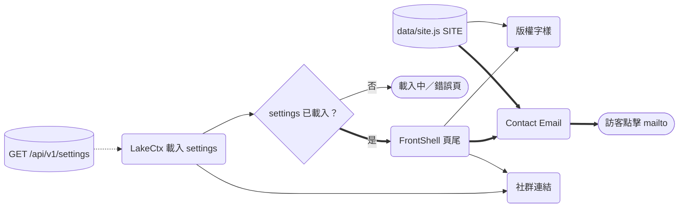
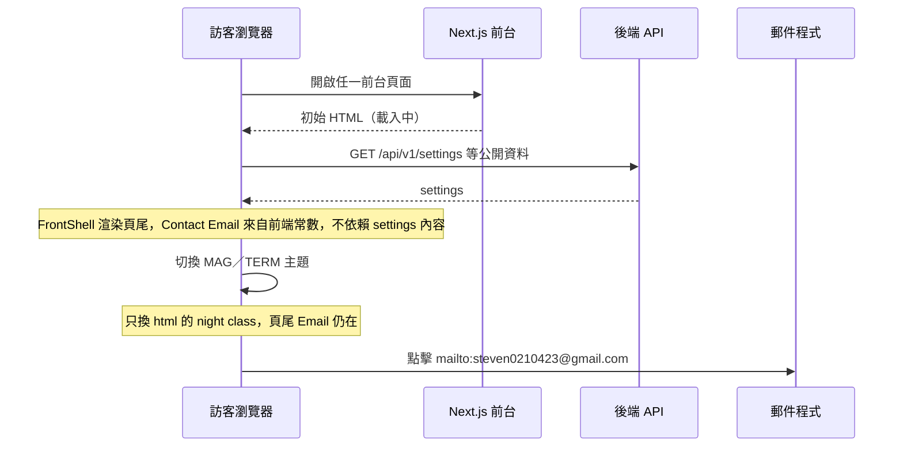

# Design：前台頁尾加上聯絡 Email（SDP-187）

## Context

- 所有前台頁面（`app/(front)/**`）都由 `app/(front)/layout.jsx` 包進 `components/front/front-shell.jsx`，頁尾 `<footer>` 只在這裡寫一次。
- 頁尾目前左側是 `SITE.copyright`（`data/site.js` 的站台常數），右側是 `db.settings.social`（後端 `/api/v1/settings` 回傳、後台「網站設定」可編輯的社群連結，依 `lib/safe-url.mjs` 的 `classifyHref` 渲染）。
- 主題切換只是在 `<html>` 加減 `night` class，`globals.css` 以 CSS 變數切換配色（day＝Magazine、night＝Terminal）。頁尾是兩種主題共用的同一段 JSX，所以只要頁尾有 Email，兩種主題都會顯示。
- 頁尾容器帶 `mono uppercase tracking-[.15em]`，直接放 Email 會顯示成大寫 `STEVEN0210423@GMAIL.COM`。
- `FrontShell` 是 client component，settings 載入完成前會顯示「載入中…」全頁狀態、載入失敗會顯示錯誤頁，這兩種狀態都沒有頁尾。`next start` 回應的初始 HTML 也是「載入中…」，因此用 `curl` 抓 HTML 看不到頁尾內容。
- `design-sync/manifest.json`：`data/site.js` 對應設計檔 `project/data.js`，`components/front/front-shell.jsx` 對應 `project/v2/front-home.jsx`，兩者都已有 `deviations` 機制記錄刻意偏離設計稿的地方。

## Goals / Non-Goals

**Goals:**

- 所有前台頁面的頁尾都看得到聯絡 Email，兩種主題皆然。
- Email 以原文小寫顯示，點擊開啟郵件程式（`mailto:`）。
- 日後 `/design-pull` 不會把這段改動覆蓋回設計稿。

**Non-Goals:**

- 不做聯絡表單、不新增後端端點或資料表欄位。
- 不讓後台可編輯此 Email（要改就改程式碼常數）。
- 不改「載入中／載入失敗」全頁狀態的呈現（這兩種狀態本來就沒有頁尾，見 Risks）。
- 不調整社群連結的網址分類規則。
- 不處理後台（`/admin`）的版面。

## Decisions

### D1：Email 放在站台常數 `SITE`，不放後台網站設定

- **做法**：`frontend/data/site.js` 的 `SITE` 新增 `contactEmail: "steven0210423@gmail.com"`，頁尾讀這個值。
- **理由**：綠界審核要的是穩定存在的聯絡方式。放在程式碼常數裡由規格與審查把關，不會因後台誤刪、資料庫重建而消失；與同樣是站台固定資訊的 `copyright` 放在一起。
- **替代方案**：
  - 在後台「網站設定」的社群連結手動加一筆 `mailto:` 連結：不用改程式碼，但內容只存在資料庫，staging／production 各自要手動設，也沒有規格保障，且會被頁尾的 `uppercase` 轉成大寫。不採用。
  - 常數直接寫在 `front-shell.jsx`：少動一個檔案，但站台資訊分散。不採用。

### D2：頁尾版面

- **做法**：在頁尾既有的版權字樣旁（左側區塊）加一個聯絡區塊：標籤「Contact」（沿用頁尾 mono 大寫樣式）＋ Email 連結 `<a href="mailto:steven0210423@gmail.com">`。Email 連結加 `normal-case`（必要時一併取消字距），讓 Email 以小寫原文顯示；hover 樣式沿用頁尾連結的 `hover-rule`。
- **連結行為**：`mailto:` 不開新分頁、不加 `target="_blank"`（交由瀏覽器開啟郵件程式）。這是固定值，不經過 `classifyHref`（該函式是給使用者輸入的網址用的）。
- **響應式**：頁尾在手機為直向堆疊（`flex-col`）、`sm` 以上橫向排列，新區塊沿用同一結構，不另寫斷點邏輯。
- **主題**：不寫死色值，沿用 `v-dim`／`v-acc` 等主題 class，兩種主題自動套用各自配色。
- 精確的 class 與排版由前端 Agent 依現有頁尾風格決定，以規格（`specs/site-contact-info/spec.md`）的可觀察行為為準。

### D3：不加功能開關

CLAUDE.md「功能開關（SDP-149）」適用於「一般瀏覽者可**操作**的功能（表單、按鈕、互動區塊）」。本次是靜態公開資訊加一個 `mailto:` 連結：

- 沒有表單、沒有寫入、沒有後端端點，性質與頁尾既有的社群連結相同（社群連結也沒有開關）；
- 規則也寫明「只藏操作區塊，不藏導覽與既有公開內容」；
- 這個 Email 的目的就是讓綠界審核方隨時看得到，若預設停用反而違背需求。

因此不新增 `featureRegistry` key、不包 `FeatureGate`。

### D4：design-sync 偏離紀錄

改到設計稿對應的前端檔案，要讓 `/design-pull` 移植時不覆蓋。於 `frontend/design-sync/manifest.json`：

- `project/data.js` 底下新增 `deviations`（目前沒有此欄位）：`{ target: "data/site.js", issue: "SDP-187", since: "<實作日期>", note: "SITE 新增 contactEmail（頁尾聯絡 Email，綠界審核需要）" }`；
- `project/v2/front-home.jsx` 的 `deviations` 追加：`{ target: "components/front/front-shell.jsx", issue: "SDP-187", since: "<實作日期>", note: "頁尾新增聯絡 Email（mailto 連結，Email 不套用 uppercase）" }`。

不改 `sha256`、`targets`、`syncedVersion`（設計稿本身沒變）。`npm run test:design` 會驗證差異工具，manifest 格式要維持可解析。

## 資料流圖

- 新增的只有 `SITE.contactEmail` → 頁尾 Contact 區塊這條；Email 不經過後端。
- 依據：`frontend/components/front/front-shell.jsx`、`frontend/data/site.js`、`frontend/store/lake-context.jsx`

## 互動時序圖

- 本次**沒有新的前後端往返**；圖中後端請求是既有流程，畫出來是為了說明頁尾要等 settings 載入後才出現。
- 依據：`frontend/store/lake-context.jsx`、`frontend/app/(front)/layout.jsx`

## Risks / Trade-offs

- [後端無法回應時，前台只顯示錯誤頁，看不到頁尾 Email] → 與現有版權字樣、社群連結相同的既有行為，本次不改；審核時網站應為正常狀態。若日後需要在錯誤頁也顯示聯絡方式，另開 issue。
- [Email 公開在網站上可能收到垃圾郵件] → issue 作者明確要求公開；不做混淆（混淆會讓審核方或爬蟲判讀失敗，違背需求）。
- [`/design-pull` 覆蓋改動] → D4 的偏離紀錄。
- [初始 HTML 看不到 Email，curl 觀察點只能驗證打包產物] → 執行驗證以打包產物檢查為主；畫面需人工或截圖確認（本專案尚未設定截圖工具）。

## Migration Plan

純前端顯示，隨前端映像部署；回滾即 revert 本次 commit。無資料遷移。

## 執行驗證觀察點

前台頁尾由 client component 在 settings 載入後才渲染，`next start` 的初始 HTML 只有「載入中…」，且專案「## 執行驗證」沒有提供截圖指令，所以改用打包產物的指令觀察點（在 worktree 根目錄、前端已 `npm run build` 後執行）：

1. `grep -rlF 'steven0210423@gmail.com' frontend/.next/static | wc -l` → `大於 0`（Email 已打包進前台 JS）
2. `grep -rlF 'mailto:' frontend/.next/static | xargs grep -lF 'steven0210423@gmail.com' | wc -l` → `大於 0`（同一份 chunk 同時含 `mailto:` 與 Email，代表以郵件連結呈現）
3. `curl -s -o /dev/null -w '%{http_code}' localhost:3100/` → `200`（頁尾所在的首頁在改動後仍可正常回應）

畫面上「兩種主題都顯示、Email 為小寫」無法以上述指令證明，交由 Akafuku 審查 diff 時對照規格確認（頁尾是兩主題共用的單一 JSX、Email 有 `normal-case`）。

## 變異測試目標

無。本次只新增靜態顯示內容與一個固定的 `mailto:` 連結，沒有權限檢查、狀態機、計算或分支邏輯；專案也尚未設定變異測試指令。
