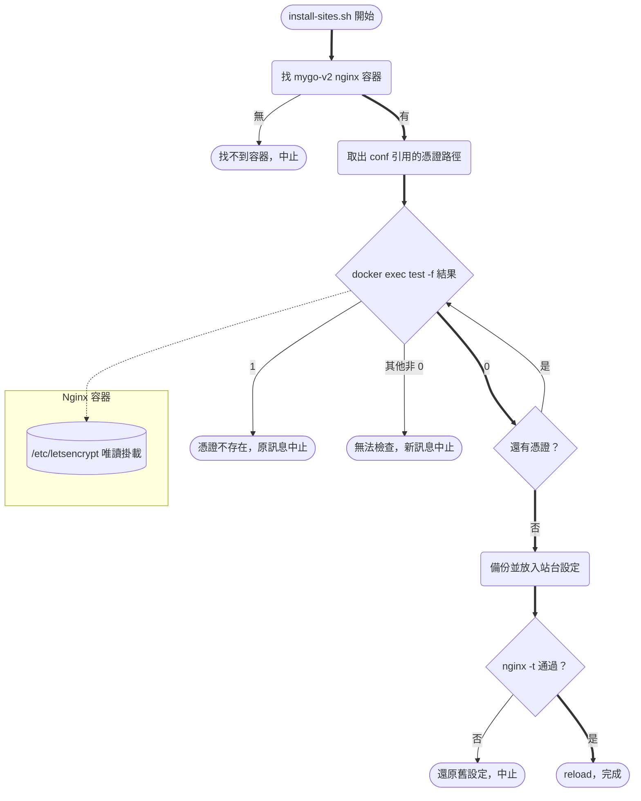
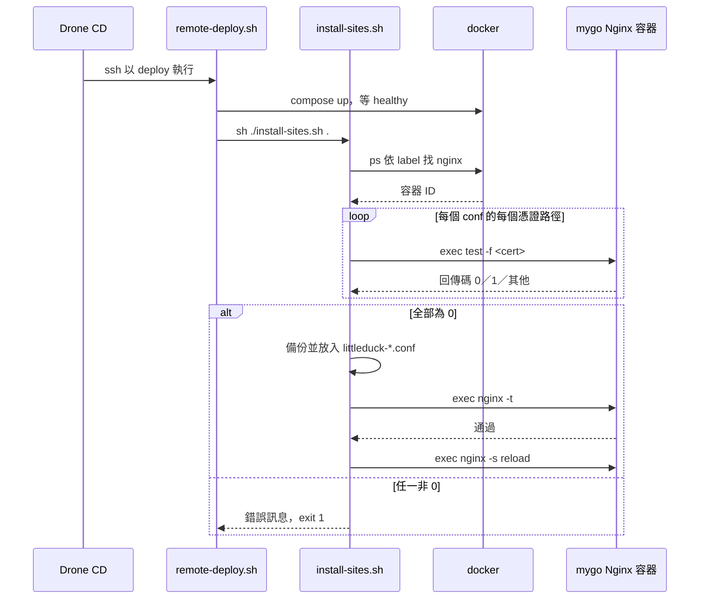

## Context

動機見 proposal.md「Why」。現況與限制：

- `deploy/edge/install-sites.sh` 由兩條路徑以 `deploy` 帳號執行：runbook 第 1 節手動安裝 Drone 站台（`ssh deploy@<主機> 'sh /tmp/install-sites.sh /tmp'`），以及 CD 的 `deploy/ci/remote-deploy.sh`（容器 healthy 後 `sh ./install-sites.sh .`）。兩條路徑都由 `backend-bundle.sh`／`frontend-bundle.sh` 以**明確檔名**把 `install-sites.sh` 複製進 bundle，新增的測試腳本不會被帶上主機。
- 腳本第 15–18 行已先找出 mygo-v2 的 Nginx 容器（`docker ps -q --filter label=com.docker.compose.project=mygo-v2 --filter label=com.docker.compose.service=nginx`），之後也用 `docker exec` 跑 `nginx -t`；`deploy` 在 docker 群組。
- mygo_v2_anon 的 `docker-compose.prod.yml` 把主機 `/etc/letsencrypt` 以相同路徑唯讀掛進 Nginx 容器；容器內以 root 執行，`live/` 內的 symlink 指向 `archive/`，整棵樹都有掛，`test -f` 會跟隨 symlink。
- 站台樣板引用兩個檔案：`fullchain.pem` 與 `privkey.pem`，腳本以 `grep -o '/etc/letsencrypt/live/[^;]*'` 取出，兩個都檢查。

## Goals / Non-Goals

**Goals:**
- 主機憑證目錄維持 certbot 預設的 700 時，`install-sites.sh` 仍能正確判斷憑證是否存在。
- 憑證不存在時的錯誤訊息與中止行為與現在相同（文字不變）。
- 提供本機可重跑、不依賴正式主機的驗證腳本。

**Non-Goals:**
- 不改主機權限（改回 700 由 user 在合併後手動執行）。
- 不改 `remote-deploy.sh`、`.drone.yml`、bundle 腳本與站台樣板。
- 不改找容器、備份、`nginx -t`、還原的既有邏輯。
- 不把測試腳本接進 Drone CI（CI 目前只有 `ci-backend`、`ci-frontend`；要接另開 issue）。

## Decisions

### 1. 用 `docker exec "$nginx_container" test -f "$cert"` 取代主機上的 `[ -f "$cert" ]`

- **理由**：檢查的是 Nginx 實際會讀到的檔案（掛載路徑、symlink 都以 Nginx 的視角判斷），且容器內是 root，不受主機目錄 700 影響；`deploy` 不需 sudo。
- **替代方案**：
  - 放寬主機權限（目前的繞過）：等於永久降低憑證目錄的保護，被否決。
  - 給 `deploy` 免密 sudo 執行 `test`：違反 runbook「`deploy` 無 sudo」前提。
  - 另起一個掛 `/etc/letsencrypt` 的臨時容器檢查：多一次映像拉取，且檢查的不是 Nginx 實際掛載，較不準。

### 2. 區分「憑證不存在」與「無法檢查」

`test -f` 檔案不存在回 1；`docker exec` 自身失敗（容器消失、無法執行指令）回 125／126／127 等非 1 的值。腳本依回傳碼分流：

- 回 1 → 原訊息 `<conf>：憑證 <路徑> 不存在，請先依 runbook 核發`，exit 1。
- 其他非 0 → 新訊息，內容需包含 conf 檔名、憑證路徑與「無法在 Nginx 容器內檢查」字樣，exit 1。
- 回 0 → 繼續下一個檔案。

寫法要能在 `set -eu` 下取得回傳碼（例：`if docker exec ...; then ...; else rc=$?; ...`），維持 POSIX `sh`（腳本以 `sh` 呼叫，不可用 bash 語法）。

- **理由**：避免把容器問題誤報成「請先核發憑證」，誤導排錯方向。
- **替代方案**：所有非 0 都視為不存在。較簡單，但會重現本 issue 的「誤報不存在」類問題，被否決。

### 3. 新增 `deploy/edge/test-install-sites.sh` 作為本機驗證

以真實 Docker 起一個假的 Nginx 容器模擬主機，不 mock 腳本本身：

- 映像固定版本（例：`nginx:1.27-alpine`），加上 label `com.docker.compose.project=mygo-v2`、`com.docker.compose.service=nginx`，讓 `install-sites.sh` 原樣找到它。
- 測試憑證**只建立在容器內**（`docker exec <容器> sh -c 'mkdir -p ... && touch ...'`），主機上沒有同路徑檔案；這樣「憑證存在」案例通過即證明檢查不是在主機上做。
- 以 `EDGE_SITES_DIR` 指向暫存目錄，不碰 `/opt/edge-sites`。
- 「無法檢查」案例：在 PATH 最前面放一個 `docker` 包裝腳本，遇到 `exec <id> test ...` 回 126，其餘轉呼叫真正的 docker。
- 開頭若偵測到本機已有同 label 的容器就中止（避免誤操作真正的 mygo Nginx），`trap` 在結束時 `docker rm -f` 測試容器並刪除暫存目錄。
- 每個案例印 `PASS: <案例>` 或 `FAIL: <案例>：<原因>`；全部通過時最後一行印 `ALL PASS`、exit 0，否則 exit 1。

### 4. 文件同步

- `docs/cicd.md`「Nginx 站台」：說明憑證檢查在 mygo 的 Nginx 容器內進行。
- `docs/deployment-runbook.md`：在第 1 節（Drone 站台）與第 2、3 節「憑證」步驟附近註明檢查在 Nginx 容器內、**不需要**放寬 `/etc/letsencrypt/live`、`archive` 權限（維持 certbot 預設 700）；並記一行「SDP-117 期間曾 `chmod 755` 暫時繞過，本變更上線後改回 `chmod 700`」。
- 在 `deploy/edge/install-sites.sh` 開頭註解補上前置：Nginx 容器須以相同路徑掛載 `/etc/letsencrypt`。

## 資料流圖

- 檢查發生在容器內，主機 `/etc/letsencrypt/live`、`archive` 的權限不影響結果。
- 依據：`deploy/edge/install-sites.sh`、`deploy/ci/remote-deploy.sh`

## 互動時序圖

本次沒有前端與後端 API，不畫前後端互動時序圖；改畫 CD 部署時各元件的互動（本變更唯一的執行情境）。

- 手動安裝 Drone 站台時，`Drone`／`remote-deploy.sh` 換成操作者以 `ssh deploy@<主機>` 直接呼叫，其後相同。

## Risks / Trade-offs

- [mygo_v2_anon 日後改掉 `/etc/letsencrypt` 掛載路徑] → 檢查會回報「不存在」而擋下部署，屬於安全的失敗方向（Nginx 本來也讀不到憑證）；在腳本開頭註解與 cicd.md 註明此前置。
- [測試腳本依賴本機 Docker 與拉取 `nginx` 映像] → 只在本機／integrator 檢查時執行，不進 CI；映像固定版本。
- [本機剛好有 mygo-v2 的 Nginx 容器] → 測試腳本開頭偵測到就中止，不操作它。
- [`docker exec` 比主機 `[ -f ]` 慢] → 每個站台 2 個檔案，數量很少，可忽略。

## Migration Plan

1. 合併後，下一次 CD（或手動安裝）即使用新腳本；此時主機仍是 755，行為與現在相同。
2. user 以 root 執行 `chmod 700 /etc/letsencrypt/live /etc/letsencrypt/archive`，再以 `deploy` 實機執行 `install-sites.sh`：憑證存在時安裝並 reload；以不存在的主機名測試時顯示原錯誤訊息並中止。
3. 回滾：revert 本變更並把權限改回 755（即目前的暫時繞過）。

## 執行驗證觀察點

本次不影響 `CLAUDE.md`「## 執行驗證」啟動的後端／前端服務，以下觀察點在 worktree 根目錄執行，不需要那些服務（通用觀察點照跑）。需要本機 Docker，且本機沒有 label 為 `com.docker.compose.project=mygo-v2` 的 Nginx 容器。

1. `sh -n deploy/edge/install-sites.sh && sh -n deploy/edge/test-install-sites.sh && echo ok` → `ok`
2. `docker run --rm -v "$PWD:/mnt" -w /mnt koalaman/shellcheck:v0.10.0 -s sh -S warning deploy/edge/install-sites.sh deploy/edge/test-install-sites.sh` → 沒有輸出，結束碼 0
3. `grep -c '\[ -f "\$cert" \]' deploy/edge/install-sites.sh` → `0`（主機上的檢查已移除）
4. `sh deploy/edge/test-install-sites.sh` → 含 `PASS: 憑證存在`、`PASS: 憑證不存在`、`PASS: 無法檢查` 三行，最後一行 `ALL PASS`，結束碼 0
5. `sh deploy/edge/test-install-sites.sh 2>&1 | grep -c '請先依 runbook 核發'` → `大於等於 1`（「憑證不存在」案例輸出原錯誤訊息；測試腳本要把被測腳本的 stderr 一併印出）
6. `docker ps -a --filter label=com.docker.compose.project=mygo-v2 -q | wc -l` → `0`（測試結束後沒有殘留容器）

合併後的實機驗收（主機改回 700 後以 `deploy` 執行）由 user 手動進行，不在此列，見 handoff.md。

## 變異測試目標

- `deploy/edge/install-sites.sh` 的憑證檢查分流（回傳碼 0／1／其他）：它是保護共用 Nginx 不因缺憑證而起不來的閘門。本專案尚未設定變異測試指令（且無 shell 腳本的變異測試工具），integrator 會記為略過；由 `deploy/edge/test-install-sites.sh` 的三個案例覆蓋各分支。
