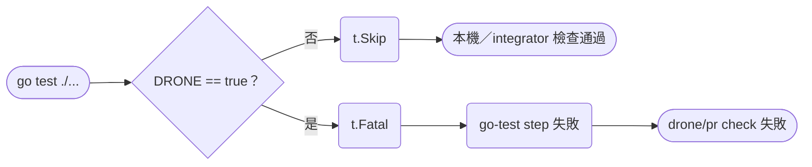
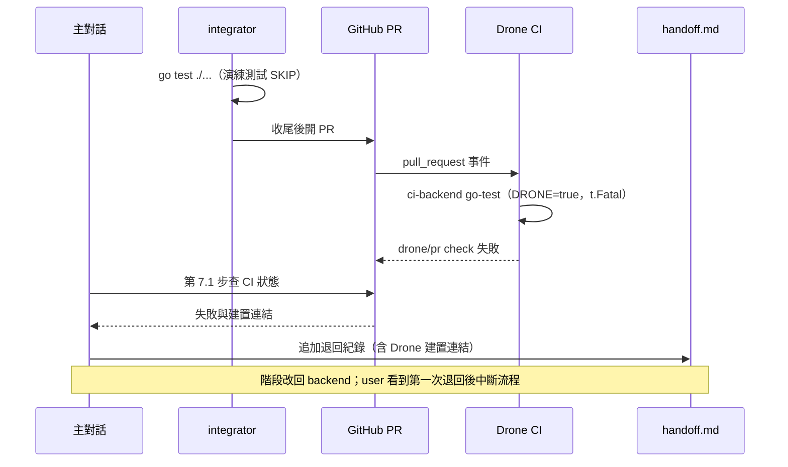

# Design：SDP-169 CI 失敗演練測試

動機見 proposal.md「Why」。

## Context

- Drone 的 `ci-backend` pipeline（`.drone.yml`）依序跑 `gofmt` → `go-vet` → `wait-postgres` → `go-test`（`cd backend && go test ./...`）→ `gosec` → `docker-build` → `trivy`。任一 step 失敗，後續 step 不執行、pipeline 失敗，GitHub 上的 `continuous-integration/drone/pr` 顯示失敗。
- Drone 會在每個 step 的容器自動注入環境變數 `DRONE=true`（以及 `CI=true`、`DRONE_BUILD_LINK` 等），不需要改 `.drone.yml`。
- 本機開發 Agent 與 integrator「檢查」跑同一個 `go test ./...`，但環境沒有 `DRONE`。
- 後端目前沒有任何 `TestMain`，加一個獨立測試函式不會影響其他測試的初始化。

## Goals / Non-Goals

**Goals：**

- 只在 Drone 裡讓 `go-test` step 失敗；本機與 integrator 檢查一律通過（演練測試顯示 SKIP）。
- 從測試名稱、檔名與失敗訊息一眼看出這是演練、不可合併。

**Non-Goals：**

- 不修改 `.drone.yml`、`frontend/`、任何執行期程式碼。
- 不新增或修改 `openspec/specs`（不涉及系統行為）。
- 不負責 `/ship-issue` 第 7.1 步的退回行為本身；那是本演練要觀察的對象。

## Decisions

### D1：以 `DRONE == "true"` 判斷是否在 CI

- 選擇：`os.Getenv("DRONE") != "true"` 時 `t.Skip(...)`，否則 `t.Fatal("CI 失敗演練（SDP-117 5.4），不可合併")`。
- 替代方案：
  - 用 `CI=true`：GitHub Actions、本機某些工具也會設，範圍太廣，可能在非 Drone 環境誤失敗。
  - 用 build tag 或在 `.drone.yml` 加環境變數：要動 `.drone.yml`，違反範圍限制，且會命中高風險檔案樣式。

### D2：檔案放在 `backend/internal/pkg/apperror/ci_failure_drill_test.go`

- 選擇：放進既有的純函式套件 `apperror`（無 DB、無外部依賴、無 `TestMain`），檔名 `ci_failure_drill_test.go`，`package apperror`，只 import `os` 與 `testing`。
- 理由：
  - CI log 中失敗的套件只有 `littleduck-backend/internal/pkg/apperror`，且該套件其他測試不依賴 DB，失敗原因只會是演練測試，判讀不會混淆；
  - 檔名明確，驗收後若要移除只需刪一個檔。
- 替代方案：新建只含 `_test.go` 的套件（如 `internal/cidrill/`）。`go test`、`go vet` 都可處理，但 `gosec` 等工具對「沒有非測試原始檔的目錄」行為不一，且新增目錄比較顯眼地改變專案結構，不採用。
- 檔頭照專案慣例寫兩行註解：檔案路徑，以及「CI 失敗演練（SDP-117 5.4）：只在 Drone（DRONE=true）失敗，本機略過；不可合併」。

### D3：不寫 delta spec

- 依 user 決定，且本變更沒有系統行為改變。`.openspec.yaml` 設 `skip_specs: true`，讓 `openspec validate --strict` 接受零 delta 的 change，不為過驗證而捏造需求。

## 資料流圖

`DRONE` 由 Drone 在每個 step 自動注入，本機與 integrator 環境沒有。

依據：`.drone.yml`（`ci-backend` 的 `go-test` step）、`backend/internal/pkg/apperror/ci_failure_drill_test.go`（待新增）

## 互動時序圖

本 change 只有後端、沒有前後端互動，改畫本演練要觀察的「主對話 ↔ GitHub ↔ Drone」互動。

依據：`.claude/commands/ship-issue.md`（第 7.1 步）、`.drone.yml`

## Risks / Trade-offs

- [誤合併後 `main` 的 CI 持續失敗] → proposal 與 issue 標題都寫明不合併；測試訊息含「不可合併」；驗收後 user 關閉 PR、刪除分支。
- [後端 Agent 被退回後把測試修掉] → issue 驗收條件寫明 user 看到第一次退回就中斷流程；`handoff.md` 也註記此事。
- [Drone 未來不再注入 `DRONE=true`] → 演練測試會在 CI 也 SKIP，CI 變成通過；本演練屬一次性，不處理。
- [CI 在 `go-test` 之前的 step 先失敗（例：gofmt）] → 會讓失敗點不是 go-test；任務的驗證方式要求 `gofmt -l .` 無輸出、`go vet ./...` 通過。

## Migration Plan

無。不部署、不合併。

## 執行驗證觀察點

以下在 worktree 根目錄執行；只看測試行為，不需要啟動服務。

1. `(cd backend && go test ./...)` → 結束碼 `0`（演練測試被略過，不影響其他測試）
2. `(cd backend && go test -v -run TestCIFailureDrill ./internal/pkg/apperror/)` → 輸出含 `--- SKIP: TestCIFailureDrill`，結束碼 `0`
3. `(cd backend && DRONE=true go test -run TestCIFailureDrill ./...)` → 結束碼非 `0`，輸出含 `CI 失敗演練（SDP-117 5.4），不可合併` 與 `FAIL	littleduck-backend/internal/pkg/apperror`，且其他套件沒有 `FAIL`

PR 開啟後的 Drone 結果（`continuous-integration/drone/pr` 失敗、失敗點為 `ci-backend` 的 `go-test`）由主對話在第 7.1 步觀察，不屬 integrator 檢查。

## 變異測試目標

無。本 change 只新增一個演練用測試，不含權限、狀態機等關鍵邏輯，也沒有被測的產品程式碼。
